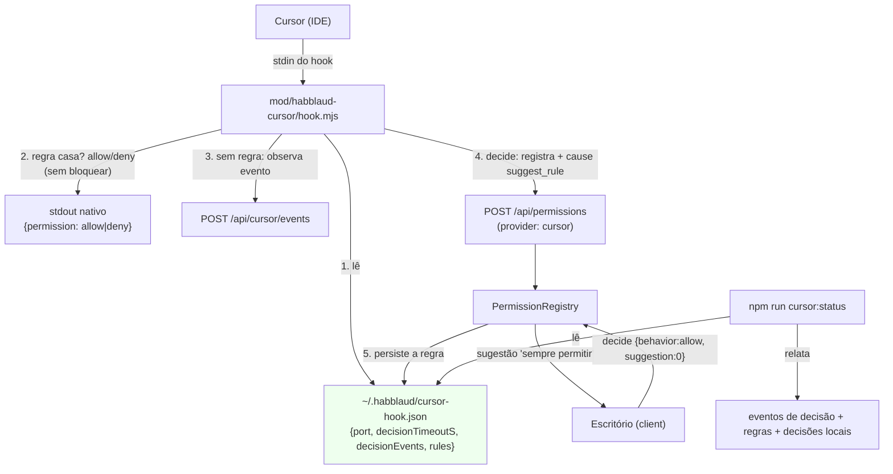

# Fluxo de permissões do Cursor Design

**Spec**: `.specs/features/cursor-permissoes/spec.md`
**Status**: Draft

---

## Architecture Overview

Adaptamos o fluxo de permissões do Cursor em **três camadas independentes**, todas aditivas e
guardadas por `provider` (conforme `AD-001`):

1. **Política local no hook** (`mod/habblaud-cursor/policy.mjs` + `hook.mjs`): corta o volume de
   decisões (por padrão só `beforeShellExecution`/`beforeMCPExecution`) e resolve regras
   `allow`/`deny` na hora — sem contatar o Habblaud nem bloquear.
2. **"Permitir sempre" pelo escritório** (`server/permissions/`): o hook manda junto do pedido a
   regra derivada (`suggest_rule`); o `PermissionRegistry` a expõe como sugestão; quando você
   escolhe "permitir sempre", o **servidor grava a regra** no arquivo de política que o hook lê.
   É a emulação do `updatedPermissions` que o Cursor não tem.
3. **Camada base + visibilidade** (`scripts/cursor-install.ts` + runbook): o
   auto-run/allowlist nativo do Cursor é a base documentada; o `cursor:status` mostra os eventos de
   decisão e as regras locais.



**Fluxo:** o hook lê a política **antes** de qualquer contato. Se uma regra casa, imprime a decisão
nativa e sai (caso S2). Senão, manda a observação e, nos eventos de decisão, registra o pedido —
junto vai a regra derivada que o escritório pode oferecer. Se você aprovar "sempre", o servidor
grava no mesmo arquivo e o próximo comando idêntico cai no atalho (1).

---

## Alternatives Considered

| # | Approach | Trade-off | Veredito |
| - | -------- | --------- | -------- |
| A | **Hook deriva e envia a regra (`suggest_rule`); servidor persiste opaco; hook aplica** | Uma única implementação de "padrão" (no hook); o servidor só grava texto validado | ✅ **Escolhido** |
| B | Servidor **deriva** o padrão a partir de `tool_input` e grava | Reimplementa o casamento do hook no TS → risco de divergência entre quem grava e quem lê | ❌ Rejeitado |
| C | **Só regras à mão** (sem "permitir sempre" no escritório) | Resolve o travamento, mas perde o mecanismo pedido (o "sempre permitir" que o Cursor não tem) | ❌ Rejeitado (fora do escopo escolhido) |
| D | Usar `matchers` do Cursor p/ **não instalar** `preToolUse`/`beforeReadFile` | Perde a observação (o escritório já usa esses eventos no feed/atividade) | ❌ Rejeitado — a redução é na *decisão*, não na observação |
| E | Fail-fast quando não há viewer | Fora do escopo priorizado (assumption da spec); o ganho já vem de A + redução de eventos | ❌ Adiado |
| F | Depender só do auto-run nativo do Cursor | Não cobre "ao vivo" no escritório, nem "sempre permitir" por pedido; muda de máquina para máquina | ❌ Rejeitado como base única; entra como camada documentada (P2) |

---

## Code Reuse Analysis

### Existing Components to Leverage

| Component | Location | How to Use |
| --------- | -------- | ---------- |
| Hook de decisão do Cursor | `mod/habblaud-cursor/hook.mjs:246` `run`; `:55` `DECISION`; `:129` `readConfig`; `:173` `permissionBody` | Ponto de entrada: trocar `DECISION` por `decisionEventsOf`, avaliar política antes de registrar, acrescentar `suggest_rule` |
| Aliases defensivos do hook | `mod/habblaud-cursor/hook.mjs:92` `toolNameOf`; `:109` `toolInputOf` | Base de `subjectOf`/`deriveRule` (ferramenta + argumentos) |
| Tradução do pedido do Cursor | `server/permissions/cursor.ts:11` `cursorToolView` | Mesmo `title`/texto/ícone; o `input` (comando/comando MCP) alimenta a regra |
| Registro de permissões | `server/permissions/registry.ts:400` `register`; `:511` `decide`; `:235` `pickSuggestions`; `:177` `unsupportedByProvider` | Generalizar para o Cursor (sugestão própria + persistência), sem tocar no caminho do Claude/Codex |
| Rotas de permissão | `server/permissions/http.ts:58` `decide` | Nada muda: `{behavior:'allow', suggestion:0}` já trafega |
| Config/`home` do servidor | `server/index.ts:73` `home: config.home`; `:131` `new PermissionRegistry({...})` | Onde plugar `persistCursorRule` |
| Cartão de permissão do cliente | `client/src/ui/permission.ts:22` `DESTINATIONS`; `:62` `permissionOptions`; `:257` `suggestions` | Rótulo do destino + remover "interromper" do Cursor |
| Escrever JSON com backup/atômico | `scripts/statusline-install.ts` `writeSettings` | Referência de escrita segura (o de regras usa temp+rename, sem backup) |
| Status do instalador | `scripts/cursor-install.ts:310` comando `status`; `:323` linha da config | Acrescentar o relatório de eventos/regras |
| Convenção de testes do host | `server/test/cursor-hook.test.ts` (hook como processo real); `server/permissions/registry.test.ts` | Onde colocar os testes novos |

### Integration Points

| System | Integration Method |
| ------ | ------------------ |
| `~/.habblaud/cursor-hook.json` | Ganha `decisionEvents` e `rules` (o hook lê; o servidor grava regras) |
| `server/index.ts` | +1 opção ao `PermissionRegistry`: `persistCursorRule` |
| `package.json` | Sem scripts novos (`cursor:install/uninstall/status` já existem) |
| `server/tsconfig.json` | `scripts/cursor-install.ts` já está no `include`; `server/permissions/cursor-rules.ts` cai em `server/**` |
| Testes | `server/test/cursor-policy.test.ts` (novo), `server/test/cursor-hook.test.ts` (estende), `server/permissions/cursor-rules.test.ts` (novo), `server/permissions/registry.test.ts` (estende), `client/src/ui/permission.test.ts` (estende), `server/test/cursor-install.test.ts` (estende) |

---

## Components

### `policy.mjs` — política local (pura, sem rede)

- **Purpose**: decidir quais eventos pedem decisão e aplicar regras `allow`/`deny` — o coração de "não
  parar o tempo todo".
- **Location**: `mod/habblaud-cursor/policy.mjs`
- **Interfaces**:
  - `DEFAULT_DECISION_EVENTS: Set<string>` — `{beforeShellExecution, beforeMCPExecution}`.
  - `decisionEventsOf(config): Set<string>` — `config.decisionEvents` (array de nomes) sobrescreve;
    vazio/inválido = padrão.
  - `rulesOf(config): CursorRule[]` — valida cada regra (`tool`/`pattern` não vazios, `effect` ∈
    {allow,deny}); descarta inválidas.
  - `subjectOf(tool, input): string | undefined` — Shell → `command`/`cmd`; Read → `file_path`; MCP →
    nome da ferramenta; resto → `JSON.stringify(input)`.
  - `matchRule(rules, tool, input): { effect; rule } | undefined` — testa cada regra do `tool` (ou
    `tool === '*'`); `deny` vence `allow`; regex inválida é ignorada.
  - `deriveRule(tool, input): CursorRule | undefined` — regra `allow` de **prefixo** ancorado
    (`^` + padrão escapado + `(\s|$)` p/ Shell; `^` + path p/ Read; `^…$` p/ MCP); `undefined` sem
    sujeito.
  - `ruleText(rule): string` — texto de exibição (ex.: `Shell(npm test)`).
  - `allowOutput()` / `denyOutput(reason)` — saída nativa do Cursor (`{permission}`/`{permission,user_message}`).
- **Dependencies**: `node:*` (nenhuma além)
- **Reuses**: os aliases de `toolNameOf`/`toolInputOf` (mesma derivação do hook)

### `hook.mjs` — aplica a política e oferece a regra

- **Purpose**: usar a política antes de qualquer contato; mandar `suggest_rule` no pedido.
- **Location**: `mod/habblaud-cursor/hook.mjs` (modifica)
- **Interfaces**:
  - `run()` passa a usar `decisionEventsOf(cfg)` no lugar de `DECISION`.
  - Para um evento de decisão: `matchRule` antes de `POST /api/cursor/events`; casou → `allowOutput`/
    `denyOutput` + registro local da decisão + `return` (sem rede).
  - `permissionBody()` acrescenta `suggest_rule: deriveRule(...)` quando derivável.
- **Dependencies**: `./policy.mjs`
- **Reuses**: `readConfig`, `call`, `decisionOutput`, `run` inteiros

### `cursor-rules.ts` — leitura/escrita do arquivo de política (servidor)

- **Purpose**: gravar a regra de "sempre permitir" e (.ts) dar suporte ao `status`.
- **Location**: `server/permissions/cursor-rules.ts` (novo)
- **Interfaces**:
  - `interface CursorRule { tool: string; pattern: string; effect: 'allow' | 'deny'; note?: string }`
  - `cursorConfigPath(home): string` — `~/.habblaud/cursor-hook.json`.
  - `readCursorConfig(home): { decisionEvents?: string[]; rules: CursorRule[] }` — nunca lança.
  - `addCursorRule(cfg, rule): cfg` — pura; não duplica `tool+pattern+effect`; respeita um teto.
  - `writeCursorRule(home, rule): { ok: true } | { ok: false; error: string }` — lê, mescla, grava
    com **temp + rename** (o hook nunca lê um arquivo pela metade).
- **Dependencies**: `node:fs`, `node:path`
- **Reuses**: o formato do arquivo que o hook já lê (`mod/habblaud-cursor/hook.mjs:129`)

### `registry.ts` — sugestão "sempre permitir" do Cursor (servidor)

- **Purpose**: expor a regra derivada como sugestão e persistí-la na decisão.
- **Location**: `server/permissions/registry.ts` (modifica)
- **Interfaces**:
  - `parseHookInput` ganha `cursorRule?: CursorRule` (de `suggest_rule`, validado; `effect` forçado
    `allow`).
  - `register` (provider cursor + `cursorRule`): `info.suggestions = [{ index: 0, rules: [ruleText],
    destination: 'habblaud' }]` e guarda `p.cursorRule`.
  - `unsupportedByProvider`: `cursor` aceita `suggestion` (segue recusando `interrupt`); `codex`
    inalterado.
  - `decide` (cursor + `suggestion`): chama `opts.persistCursorRule?.(p.cursorRule)` depois de resolver
    `allow`.
  - `RegistryOptions.persistCursorRule?: (rule: CursorRule) => void`.
- **Dependencies**: `./cursor-rules` (tipo), `./cursor` (view)
- **Reuses**: `pickSuggestions` (não para o Cursor — a sugestão é própria), `resolve`, `addActivity`

### `server/index.ts` — fiação

- **Purpose**: ligar a persistência ao `home` real, sem derrubar o servidor.
- **Location**: `server/index.ts` (modifica)
- **Interfaces**: `persistCursorRule: (rule) => { const r = writeCursorRule(config.home, rule); if
  (!r.ok) log.warnOnce(...); }`.
- **Dependencies**: `./permissions/cursor-rules`
- **Reuses**: o bloco `new PermissionRegistry({...})` (`:131`)

### `permission.ts` — cartão do Cursor (cliente)

- **Purpose**: mostrar "sempre permitir" (regra local) e não oferecer "interromper" no Cursor.
- **Location**: `client/src/ui/permission.ts` (modifica)
- **Interfaces**:
  - `DESTINATIONS` ganha `habblaud: 'no Habblaud (regra local do Cursor)'`.
  - `permissionOptions`: ramo `cursor` → `{ always: !!p.suggestions?.length, interrupt: false,
    reasonRequired: false, seconds: false, note: '' }`.
- **Dependencies**: `shared/types`
- **Reuses**: `KeyedList` de sugestões, `destinationLabel`

### `cursor-install.ts` — `status` informativo

- **Purpose**: mostrar o que o Cursor vai decidir e quantas regras/ decisões locais existem.
- **Location**: `scripts/cursor-install.ts` (modifica)
- **Interfaces**: `status` passa a imprimir eventos de decisão (config/padrão), nº de regras
  (`readCursorConfig`) e nº de decisões locais (linhas de `~/.habblaud/cursor-decisions.jsonl`).
- **Dependencies**: `../server/permissions/cursor-rules`
- **Reuses**: o comando `status` atual (`:310`) e a linha da config (`:323`)

### Docs — runbook + roteiro

- **Purpose**: documentar o auto-run do Cursor e o formato das regras; registrar a feature no roteiro.
- **Location**: `docs/analise/11-permissoes-cursor.md` (fork) + `docs/analise/06-arquitetura-proposta.md` §6.8
- **Interfaces**: passo de auto-run, formato de `rules`, "sempre permitir", eventos; ponteiro para a feature.
- **Dependencies**: nenhuma
- **Reuses**: o formato dos runbooks `08`/`10`

---

## Data Models

### `CursorRule` (arquivo de política)

```typescript
interface CursorRule {
  tool: string;                    // ferramenta do Cursor ("Shell", "Read", "mcp__x") ou "*"
  pattern: string;                 // regex testada contra o "sujeito" da ferramenta
  effect: 'allow' | 'deny';        // deny vence allow quando as duas casam
  note?: string;                   // texto legível (o que a regra cobre)
}
```

### Config `~/.habblaud/cursor-hook.json` (estendido)

```jsonc
{
  "port": 4747,                              // já existia
  "decisionTimeoutS": 25,                    // já existia
  "decisionEvents": ["beforeShellExecution", "beforeMCPExecution"], // opcional; padrão = só esses dois
  "rules": [                                 // opcional; escrito pelo "permitir sempre" (ou à mão)
    { "tool": "Shell", "pattern": "^npm test(\\s|$)", "effect": "allow", "note": "comando: npm test" }
  ]
}
```

### `suggest_rule` (hook → servidor)

```jsonc
{ "tool": "Shell", "pattern": "^git status(\\s|$)", "note": "comando: git status" }
```

**Relationships**: o hook **deriva** `suggest_rule`, o servidor **persiste** o mesmo objeto em `rules`,
e o hook **lê** `rules` na próxima vez. Nenhum modelo de produção existente muda.

---

## Error Handling Strategy

| Cenário | Tratamento | Impacto para o usuário |
| ------- | ---------- | ---------------------- |
| Política ausente/malformada | `readConfig` já tolera; `rulesOf` devolve `[]` | Fluxo anterior (registra e espera) |
| Regra com regex inválida | `matchRule` ignora a regra e segue | Aquela regra não vale; nada quebra |
| Duas regras casam | `deny` vence | Comportamento previsível |
| Sem sujeito para derivar regra | Sem `suggest_rule` → sem botão "sempre" | Aprovação simples continua |
| Falha ao gravar a regra | `writeCursorRule` devolve `{ok:false}`; `index.ts` loga e a decisão `allow` vale | A aprovação de agora vale; o "sempre" não persiste |
| `suggest_rule` forjado/ inválido | `parseHookInput` valida; campo descartado | Sem sugestão; sem gravação |
| Gravação concorrente (servidor) vs leitura (hook) | temp + rename atômico | O hook nunca lê JSON pela metade |
| Arquivo de decisões local indisponível | append best-effort, nunca lança | Só não conta no `status` |

---

## Risks & Concerns

| Concern | Location (file:line) | Impact | Mitigation |
| ------- | -------------------- | ------ | ---------- |
| **Divergência entre quem grava e quem lê** (design) | `mod/habblaud-cursor/policy.mjs` vs `server/permissions/*` | Regra gravada com padrão que o hook não casa | O hook **deriva** o padrão (fonte única); o servidor só valida/grava; teste de contrato do `suggest_rule` |
| **Regra perigosa gravada** (security) | `rules` (`~/.habblaud/cursor-hook.json`) | "sempre permitir" num comando destrutivo libera tudo | A regra é por comando exato (prefixo); doc avisa; `deny` explícito sempre vence |
| **`suggest_rule` é entrada não confiável** (security) | `registry.ts` `parseHookInput` | Texto arbitrário persistido no arquivo do usuário | Validar `tool`/`pattern` (tamanho, tipo), forçar `effect:'allow'`, teto de regras |
| **`interrupt` no Cursor sem suporte** (test gap) | `client/src/ui/permission.ts:62` | Botão que o servidor recusaria (`unsupported`) | Ramo `cursor` do `permissionOptions` desliga "interromper"; teste no `permission.test.ts` |
| **Arquivo de config compartilhado** (fragile) | `~/.habblaud/cursor-hook.json` | Corrida servidor-grava × hook-lê | temp + rename atômico; hook tolera malformado |
| **`index.ts` é raiz de composição** (test gap) | `server/index.ts:131` | Fiação não coberta por teste unitário | `cursor-rules.test.ts` cobre o gravador; a fiação fica no gate de build |
| **Observação perdida nos comandos auto-aprovados** (trade-off) | `hook.mjs` `run` | O feed não mostra o comando coberto por regra | Intencional (S2 não contata o Habblaud); registrado localmente para o `status` |
| **`DECISION` vira dinâmico** (regressão) | `mod/habblaud-cursor/hook.mjs:55` | Testes antigos assumem `preToolUse`/`beforeReadFile` decidindo | Atualizar `cursor-hook.test.ts`; padrão novo é explícito e sobrescrevível |

---

## Tech Decisions

| Decision | Choice | Rationale |
| -------- | ------ | --------- |
| Onde o padrão é derivado | **No hook** (`deriveRule`) e enviado em `suggest_rule` | Uma implementação só; o servidor grava opaco → sem divergência |
| Ordem de avaliação | `deny` > `allow` > escritório | Determinismo e segurança |
| Semântica do padrão derivado | **Prefixo ancorado** (`^…(\s|$)`) para Shell/Read; exato para MCP | Pega variações úteis (`npm test --watch`) sem virar coringa |
| Onde a regra mora | `~/.habblaud/cursor-hook.json` (`rules`) | O hook já lê esse arquivo; zero serviço novo |
| Quem grava a regra | O **servidor** (o hook não expressa "sempre") | O Cursor não tem `updatedPermissions`; a decisão chega ao servidor |
| Reduzir decisão sem perder observação | Só `DECISION` muda; o hook **continua instalado** em todos os eventos | Mantém feed/atividade; corta só o que bloqueia |
| `interrupt` para o Cursor | **Não** | `unsupportedByProvider` recusa (o hook do Cursor não interrompe) |
| Sugestão do Cursor | `destination: 'habblaud'` | Deixa claro que a regra fica no arquivo local do Habblaud, não no Cursor |
| Log de decisões locais | `~/.habblaud/cursor-decisions.jsonl` (best-effort) | Mede o travamento sem instrumentação extra |

> **Project-level decisions:** append **`AD-002`** a `.specs/STATE.md`: "o 'sempre permitir' do Cursor
> é emulado por uma **política local** (`~/.habblaud/cursor-hook.json`) gravada pelo **servidor** e
> aplicada pelo **hook** (o Cursor não tem `updatedPermissions`)". O design **conforma com `AD-001`**
> (aditivo, guardado por `provider`); as demais decisões são locais à feature.

---

## Tips

- **Reduzir antes de automatizar**: só o corte de eventos (P1) já resolve a maior parte do "parando o
  tempo todo"; as regras são o refinamento.
- **Contrato do `suggest_rule`**: um teste que roda o hook como processo e confere o JSON do pedido
  trava a fonte única do padrão.
- **Não confundir decisão com observação**: o hook continua instalado nos 15 eventos; o que muda é o
  conjunto que **espera resposta**.
