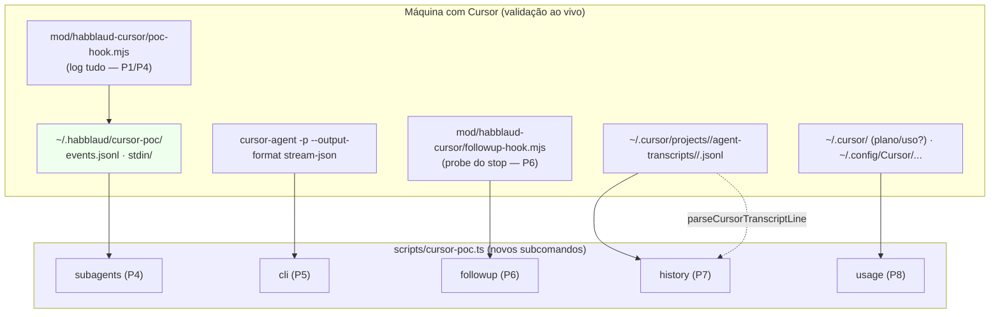

# POCs Cursor (P4–P8) Design

**Spec**: `.specs/features/cursor-poc-p4-p8/spec.md`
**Status**: Draft

---

## Architecture Overview

Estendemos o **harness local** das POCs (`scripts/cursor-poc.ts` + `mod/habblaud-cursor/`) com cinco
analisadores e um probe. Tudo é **descartável** e roda no host, sem tocar no caminho de produção
(`CursorSource`/`Office`/`Hub` vivos). O design **conforma com `AD-001`** (nada é reescrito; a POC só
generaliza o harness). Cada analisador lê **uma** fonte (diretório, arquivo ou `stdin`) e imprime um
relatório legível; nenhum faz rede.



**Fluxo:** (P4) o `poc-hook.mjs` (com `subagentStart`/`subagentStop` recém-instalados) anota
`events.jsonl`; `subagents` correlaciona. (P5) o usuário salva o NDJSON do CLI; `cli` caracteriza.
(P6) o `followup` roda o probe com um `stop` sintético e valida a saída. (P7) `history` varre os
transcripts e detecta `git`/`gh`. (P8) `usage` varre os locais de plano/uso.

---

## Evidência real (export do usuário, 2026-10-10)

O usuário empacotou dados reais em `docs/cursor-export/` (fora dos commits — dados pessoais). Eles
**groundam** o design e já respondem parte das perguntas:

| POC | Evidência observada | Leitura |
| --- | ------------------- | ------- |
| **P4** | `p4-events.jsonl` (**1784** eventos, 0 linhas ruins) com `preToolUse`/`postToolUse`/`afterAgentThought`/`stop` etc. **e nenhum `subagentStart`/`subagentStop`**; `tool_name` inclui **`Task` (3×)**; `composer_mode:"agent"` (20×) | O IDE usa subagente (`Task`), mas **não temos como saber** se há hook de subagente: `HARNESS_EVENTS` (`scripts/cursor-poc.ts:34`) **nunca instalou** `subagentStart`/`subagentStop`. **Correção de método**: instalá-los e re-testar (AC CP48-05). |
| **P7** | 2 transcripts reais (`agent-transcripts/*.jsonl`) parseiam limpos: `roles user/assistant`, `turn_ended`, tools `Read/Glob/Write/Grep/Shell/StrReplace/GetDynamicTools/CallDynamicTool/AskQuestion/UpdateCurrentStep/List`; `p4-transcripts-index.txt` com **5 sessões distintas** em `…/projects/home-jcoelho3-habblaud/agent-transcripts/<id>/<id>.jsonl` | O caminho e o formato confirmam o P0/C1; o histórico é reconstruível. **Ferramentas novas** (`GetDynamicTools`, `AskQuestion`, `UpdateCurrentStep`, `List`) não têm tradução dedicada — caem no nome cru (aceitável na POC). |
| **P8** | Raiz de `~/.cursor`: `plans/` (26 `*.plan.md` — **plan mode**, não billing), `ai-tracking/`, `agents/`, `chats/`, `agent-cli-state.json` (388 B), `statsig-cache.json` (850 KB), `unified_repo_list.json`; hits de "uso" são quase todos **arquivos de projeto** (`projects/*/mcps/*/BILLING_-_MATRIX.json`, `planos.json`) e a extensão de terceiros **`ahmed404abd.cursor-token-monitor`**; `storage.json` só tem `telemetry.*`; `state.vscdb` em `~/.config/Cursor/User/{globalStorage,workspaceStorage}` | **Nenhuma fonte de primeira parte** de uso/plano foi confirmada. O lead vivo é **`~/.cursor/ai-tracking/`** (existe, não capturado) e a extensão token-monitor (lê o uso de *algum* lugar). Provável veredicto: **ocultar o cartão** (como previu `07`). |
| **P5** | O **CLI está instalado**: `~/.config/Cursor/User/globalStorage/anysphere.cursor-agent-worker/agent-cli/.local/share/cursor-agent/versions/<v>/` (várias versões) + `~/.cursor/agent-cli-state.json` | O runbook do P5 pode apontar para o binário instalado; falta só o NDJSON do `stream-json`. |

> **Privacidade**: `docs/cursor-export/` contém caminhos/projetos reais e **não** entra em commits
> (ver Risks). Só contagens/rótulos derivados viram evidência nos docs.

---

## Alternatives Considered

| # | Approach | Trade-off | Veredito |
| - | -------- | --------- | -------- |
| A | **Estender `scripts/cursor-poc.ts`** com 5 subcomandos + 1 probe, reaproveitando `transcript.ts`/`rollout.ts` | Concentra o harness num dono; segue o padrão P0–P3 | ✅ **Escolhido** |
| B | Fiação de **produção** (`CursorHistory`, `addSub`) já nesta rodada | Vai além da regra das POCs ("descartável"); arrisca regressão | ❌ Rejeitado — Fase 4 |
| C | Um script por POC (`cursor-poc-p4.ts`, …) | Multiplica instaladores/args/parse; duplica testes | ❌ Rejeitado — um harness, subcomandos |
| D | `subagents` só pelo **transcript** (sem hook) | Pode provar "houve subagente", mas **não** prova se há *hook* de subagente | ❌ Rejeitado como método principal; o transcript entra como **fallback** |
| E | `usage` lê **valores** de uso/plano | Privacidade + conteúdo volátil | ❌ Rejeitado — só **nomes/chaves/tabelas** |
| F | Reusar `inspectTranscript` para o `state.vscdb` do P8 | Já sabe listar tabelas+contagens de SQLite (`transcript.ts:205`) | ✅ **Escolhido** como referência do `usage` |

---

## Code Reuse Analysis

### Existing Components to Leverage

| Component | Location | How to Use |
| --------- | -------- | ---------- |
| Harness CLI (args, `RunContext`, `run`) | `scripts/cursor-poc.ts:95`, `:414`, `:430` | Acrescentar casos ao `parseArgs`/`run` no mesmo padrão |
| Leitura da captura | `scripts/cursor-poc.ts:247` `readCapturedEvents` | Base do `subagents` (eventos com nome + campos) |
| Diretório de captura | `scripts/cursor-poc.ts:235` `captureDirOf` | Reuso direto (P4) |
| Lista de eventos instalados | `scripts/cursor-poc.ts:34` `HARNESS_EVENTS` | **Acrescentar** `subagentStart`/`subagentStop` (CP48-05) |
| Parser do transcript | `server/sources/cursor/transcript.ts:247` `parseCursorTranscriptLine`; `:99` `classifyTranscript`; `:205` `inspectSqlite` | Base do `history` (P7) e referência do SQLite do `usage` (P8) |
| Tradução de ferramenta | `server/sources/cursor/rollout.ts:96` `describeCursorTool`; `:65` `parseCursorEvent` | Base do `history`/deteção de comandos |
| Hook "log tudo" | `mod/habblaud-cursor/poc-hook.mjs:64` `capture` | Molde do probe `followup-hook.mjs` (P6) |
| Config de hooks (plano) | `scripts/statusline-install.ts:251` `readSettings`, `:270` `writeSettings` | Já usado por `install`/`uninstall` |
| Stub HTTP / spawn de hook | `scripts/cursor-poc.ts:308` `startDecisionStub`, `:353` `runDecisionHook` | Molde do `followup` (spawn do probe com `stdin`) |

### Integration Points

| System | Integration Method |
| ------ | ------------------ |
| `package.json` scripts | +5: `cursor:poc:usage\|subagents\|cli\|followup\|history` |
| `server/tsconfig.json` | `scripts/cursor-poc.ts` já está no `include`; **nada novo** a incluir |
| `~/.cursor/hooks.json` | `install` passa a instalar `subagentStart`/`subagentStop` (aditivo) |
| Testes | `server/test/cursor-poc.test.ts` (estende) + `server/sources/cursor/*.test.ts` (se preciso) |

---

## Components

### `parseArgs`/`run` (extensão do harness)

- **Purpose**: reconhecer os cinco subcomandos novos.
- **Location**: `scripts/cursor-poc.ts:95` / `:430`
- **Interfaces**: somar a `RunOptions` os casos `usage {path?}`, `subagents {}`, `cli {path?}`,
  `followup {message?}`, `history {projects?}`; `USAGE` atualizado.
- **Dependencies**: `node:*`
- **Reuses**: o `switch` e o `RunContext` existentes

### `usage` (P8)

- **Purpose**: listar candidatos locais de uso/plano e o "retrato" deles, sem rede e sem valores.
- **Location**: `scripts/cursor-poc.ts` (novo bloco `// ---- usage (P8)`)
- **Interfaces**:
  - `usageRoots(home): string[]` — `[~/.cursor, ~/.cursor-server, ~/.config/Cursor]` (ou `--path`).
  - `scanUsage(root): UsageHit[]` — varre ignorando `projects|skills|plugins|extensions|node_modules`; casa `usage|plan|limit|quota|billing|credit|ai-tracking|statsig|agent-cli-state|state.vscdb`.
  - `describeUsageFile(path): string[]` — JSON → chaves de topo; SQLite → tabelas+contagens; senão, tamanho/mtime.
- **Dependencies**: `node:fs`; `node:sqlite` (tabelas)
- **Reuses**: o padrão de `inspectSqlite` (`transcript.ts:205`) e de `classifyTranscript`

### `subagents` (P4)

- **Purpose**: correlacionar `subagentStart`/`subagentStop` capturados.
- **Location**: `scripts/cursor-poc.ts` (novo bloco `// ---- subagents (P4)`)
- **Interfaces**:
  - `correlateSubagents(events: CapturedEvent[]): { pairs; orphans; total }` — casa `Start`↔`Stop`
    por `subagent_id` (`subagentId`/`id`), com o pai de `parent_conversation_id`.
  - `HARNESS_EVENTS` ganha `subagentStart`/`subagentStop`.
- **Dependencies**: `node:*`
- **Reuses**: `readCapturedEvents`, `captureDirOf`

### `cli` (P5)

- **Purpose**: caracterizar o NDJSON do `cursor-agent -p --output-format stream-json`.
- **Location**: `scripts/cursor-poc.ts` (novo bloco `// ---- cli (P5)`)
- **Interfaces**:
  - `parseCliStream(text): { kinds: Map; sessionId?; tools: Map; malformed: number }` — NDJSON com
    `type` (`system|user|assistant|tool_call|result`), `session_id`, nomes de ferramenta
    (`tool_call.tool_name|name`, `tool_calls[].function.name`), aliases defensivos.
- **Dependencies**: `node:*`
- **Reuses**: a leitura de `stdin` do estilo `poc-hook.mjs`

### `followup` + `followup-hook.mjs` (P6)

- **Purpose**: provar a forma `{followup_message}` do `stop`.
- **Location**: `mod/habblaud-cursor/followup-hook.mjs` (probe) + `scripts/cursor-poc.ts` (subcomando)
- **Interfaces**:
  - probe: lê `stdin`; se `hook_event_name === 'stop'`, imprime `{"followup_message": <texto>}`
    (`HABBLAUD_CURSOR_POC_FOLLOWUP` ou `--message`), nunca lança.
  - `followup` (`scripts/cursor-poc.ts`): spawna o probe com `{hook_event_name:'stop'}` no `stdin`,
    valida `JSON.parse(stdout).followup_message` string, saída `0`/≠`0`.
- **Dependencies**: `node:child_process`
- **Reuses**: `runDecisionHook` (`:353`) como molde

### `history` (P7)

- **Purpose**: enumerar sessões e detectar `git push`/`gh pr create|merge` a partir dos transcripts.
- **Location**: `scripts/cursor-poc.ts` (novo bloco `// ---- history (P7)`)
- **Interfaces**:
  - `enumerateSessions(projectsDir): SessionSummary[]` — varre `*/agent-transcripts/*/*.jsonl`;
    id, mtime, turnos (`role`), ferramentas (`parseCursorTranscriptLine`).
  - `detectEffects(transcriptText): string[]` — `git push`, `gh pr create|merge` (via `Shell`).
- **Dependencies**: `node:fs`; `parseCursorTranscriptLine`/`describeCursorTool`
- **Reuses**: `transcript.ts:247` (parser), `rollout.ts:96` (nomes)

---

## Data Models (harness-local; sem tipos de produção)

```typescript
// P8
interface UsageHit { path: string; kind: 'json' | 'sqlite' | 'other'; size: number; mtimeMs: number; note?: string }

// P4
interface SubagentPair { id?: string; start?: CapturedEvent; stop?: CapturedEvent; parent?: string; complete: boolean }

// P5
interface CliSummary { kinds: Map<string, number>; sessionId?: string; tools: Map<string, number>; malformed: number }

// P7
interface SessionSummary { id: string; path: string; mtimeMs: number; turns: number; tools: Map<string, number>; effects: string[] }
```

**Relationships**: nenhum modelo de produção é tocado; tudo vive no harness.

---

## Error Handling Strategy

| Cenário | Tratamento | Impacto para o usuário |
| ------- | ---------- | ---------------------- |
| Root/arquivo ausente (P8/P7) | Mensagem explicativa, saída `0` | Harness informa "nada encontrado" (é o esperado no P8) |
| JSON/SQLite ilegível (P8) | Reporta "ilegível" e segue | Nada quebra |
| `events.jsonl` sem subagente (P4) | "não observado", saída `0` | Resposta explícita da pergunta |
| Linha NDJSON corrompida (P5) | Conta como ilegível e segue | Relatório ainda útil |
| Probe sem JSON válido (P6) | Harness sai ≠ `0` com a saída crua | Falha barulhenta e diagnosticável |
| Transcript com linha estranha (P7) | `parseCursorTranscriptLine` nunca lança | Sessão listada parcialmente |
| `git`/`gh` com aspas/flag | regex tolerante (`git\s+push`, `gh\s+pr\s+(create|merge)`) | Menos falso-negativo |

---

## Risks & Concerns

| Concern | Location (file:line) | Impact | Mitigation |
| ------- | -------------------- | ------ | ---------- |
| **Método do P4 estava furado** (test gap): `HARNESS_EVENTS` não instala hooks de subagente | `scripts/cursor-poc.ts:34` | "não observado" era artefato, não resposta | Instalar `subagentStart`/`subagentStop` (CP48-05) e re-testar; fallback pelo `Task` no transcript |
| **Dados pessoais no export** (security) | `docs/cursor-export/` (raiz do repo-pai) | Vazamento de caminhos/projetos em commit | **Não commitar** o export; evidência nos docs só com contagens/rótulos; (opcional) `.gitignore` |
| **Ferramentas novas sem tradução** (test gap do P0) | `server/sources/cursor/rollout.ts:96` | `GetDynamicTools`/`AskQuestion`/`UpdateCurrentStep`/`List` caem no nome cru | Fora do escopo da POC; registrar e deixar para a Fase 1 |
| **Schema do CLI incerto** (incerteza) | `scripts/cursor-poc.ts` (novo) | Campos com outros nomes → contagens vazias | Aliases defensivos (`tool_name`/`name`, `type`/`kind`); o runbook confirma |
| **`state.vscdb` pode conter segredos/histórico** (security) | `~/.config/Cursor/User/globalStorage/state.vscdb` | Expor conteúdo na saída | `usage` só imprime **nomes de tabela + contagens**, nunca linhas |
| **`followup` depende do runtime do Cursor** (incerteza) | `mod/habblaud-cursor/followup-hook.mjs` (novo) | Só o runbook prova a injeção real | Probe validado localmente (forma) + passo de runbook (efeito) |
| **Testes do harness podem depender de `HOME` real** (flaky) | `server/test/cursor-poc.test.ts` | Teste frágil fora de `mkdtemp` | Sempre `home`/`--path` temporários (padrão já usado) |

---

## Tech Decisions

| Decision | Choice | Rationale |
| -------- | ------ | --------- |
| Onde adicionar os analisadores | **Um** harness (`scripts/cursor-poc.ts`), 5 subcomandos | Espelha P0–P3; um dono, um `parseArgs`, um teste |
| P8 ler valores? | **Não** — só nomes, chaves de topo e tabelas | Privacidade; o que importa é *existir* fonte, não o conteúdo |
| P4: hook ou transcript? | **Hook primário** (instala subagent*), transcript como fallback | Só o hook responde "o Cursor emite esse evento?" |
| P5: aceitar `stdin` | Sim, além de `--path` | Permite `… | cursor-agent … | npm run …` no runbook |
| P6: probe separado | `followup-hook.mjs`, harness só valida a forma | Mantém o hook puro (Node, nunca lança), como os demais |
| P7: reaproveitar o parser | Sim (`parseCursorTranscriptLine`) | Já lê o schema real (C1); evita um segundo parser |
| `followup` fora do `install` | Não instalar por padrão no `hooks.json` | É um experimento destrutivo ("injetar texto"); o runbook instala à mão |

> **Project-level decisions:** nenhuma nova — o design **conforma com `AD-001`** (harness aditivo;
> nada de produção reescrito). Decisões aqui são locais à POC.

---

## Tips

- **Real antes de sintético**: rodar os analisadores contra `docs/cursor-export/` já responde P4/P7/P8
  sem a máquina do usuário.
- **O que o runbook ainda precisa**: só P5 (CLI) e P6 (injeção real) + o re-teste do P4 com os hooks
  de subagente instalados.
- **Nomes de ferramenta novos** (`GetDynamicTools`, `AskQuestion`, `UpdateCurrentStep`, `List`) são
  achado de P0/C1 para a Fase 1 — anotar, não corrigir aqui.
