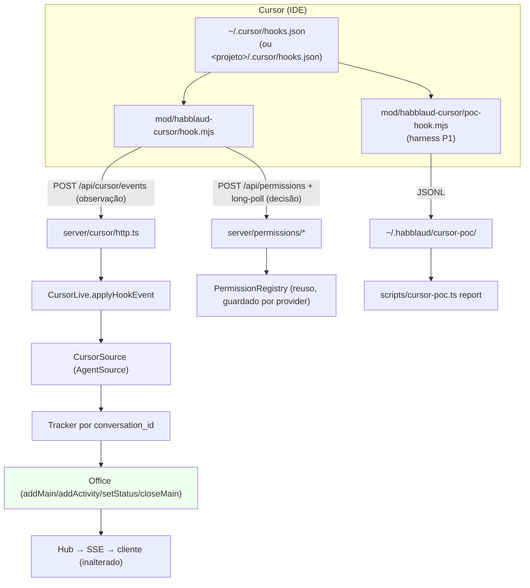

# Cursor POC Design

**Spec**: `.specs/features/cursor-poc/spec.md`
**Status**: Draft

---

## Architecture Overview

Adicionamos o Cursor como **terceiro provedor aditivo** (`Provider = 'claude' | 'codex' | 'cursor'`),
espelhando a fonte do Codex. A diferença central: o Cursor **não tem registro de sessões local
conhecido** (`05` §5.1, lacuna C2), então a presença vem **só dos hooks**. Não há polling de
rollout no MVP: o `CursorSource` não lê arquivos, apenas reage a eventos de hook empurrados pelo
`POST /api/cursor/events`.



**Fluxo de dados (P3):** o hook manda o stdin do evento para a rota; a rota valida o corpo e chama
`CursorSource.applyHookEvent`, que cria/atualiza o agente no `Office`. O `Office` propaga pelo `Hub`
(SSE) para o cliente, que já é dirigido por `provider` — nenhuma mudança de UI é necessária além do
rótulo do provedor.

**Harnesses (P0/P1/P2):** três utilitários locais que **não dependem do runtime do Cursor**:
- P1 (`hook.mjs` de captura + `cursor-poc.ts install/report`): mede cobertura de eventos.
- P0 (`cursor-poc.ts transcript` + `sources/cursor/transcript.ts`): classifica o transcript.
- P2 (`cursor-poc.ts decision`): mede o bloqueio do hook de decisão contra um stub local.

---

## Alternatives Considered

| # | Approach | Trade-off | Veredito |
| - | -------- | --------- | -------- |
| A | **Estender o Habblaud** com `provider: 'cursor'`, espelhando o Codex | Duplica a forma da fonte, mas reaproveita `Office`/`Hub`/permissões/instalador | ✅ **Escolhido** — recomendação de `06`; "se for possível estender, é prioridade" |
| B | Reescrever um subproduto só para Cursor | Joga fora `Office`, timeline, SSE, arte e o modelo multi-provedor | ❌ Rejeitado pelo usuário e por `06` §1 |
| C | Instalar pelo caminho Claude (`.claude/settings.json`, "Third-Party Plugins") | Perde `subagentStart`, `afterAgentResponse/Thought` e `loop_limit`; `PermissionRequest` **não** existe no Cursor (`05` §5.2) | ❌ Rejeitado — usar o formato **nativo** do Cursor (`06` §6.7) |
| D | Pôr os aliases de ferramenta do Cursor (`Shell`→`Bash` etc.) em `shared/activity.ts` (como sugere `06` §6.2) | Altera um arquivo compartilhado pelo caminho do Claude Code; aumenta o risco de regressão | ❌ Rejeitado — tradução fica **local** à fonte (`sources/cursor/rollout.ts`), espelhando `describeCodexTool` |
| E | Registro de permissões próprio para o Cursor | Duplica long-poll, órfãos, expiração, snapshot | ❌ Rejeitado — reusar `PermissionRegistry` com guarda por `provider` |
| F | Presença por polling do transcript | O schema do transcript é desconhecido (C1) e pode ser `null` (transcripts desabilitados) | ❌ Adiado — P0 decide; no MVP a presença é só por hook |

---

## Code Reuse Analysis

### Existing Components to Leverage

| Component | Location | How to Use |
| --------- | -------- | ---------- |
| `Office` (modelo do escritório) | `server/model/office.ts` | Reuso direto: `addMain` (`:308`), `setStatus` (`:374`), `addActivity` (`:682`), `closeMain` (`:546`), `fillWorkingActivity` (`:435`), `beginBoot`/`endBoot` |
| `AgentSource` / `SourceSet` | `server/sources/source.ts:21` / `:41` | `CursorSource implements AgentSource` e entra no `SourceSet` como o Codex |
| Precedente da fonte | `server/sources/codex/source.ts` | Mesma forma: `register()` via `accounts.setProviderAccounts('codex', …)`, `decide()` por bordas (`:670`), `applyHookEvent` (`:790`), `touch` (`:873`) |
| Tradução de ferramenta | `server/sources/codex/rollout.ts:304` `describeCodexTool` | Espelhar em `sources/cursor/rollout.ts`: `Shell`→`describeCommand`, `Read`/`Write`/`Grep`/`Task`/`MCP:…` → `describeTool` |
| Descritores de atividade | `shared/activity.ts:605` `describeCommand`, `:650` `describeTool`, `:117` `maskSecrets`, `:43` `truncate` | Reuso puro (nada novo) |
| Rota de eventos + trava local | `server/codex/http.ts` + `server/http/app.ts:334` | Copiar o padrão: `parseCodexEvent` (`400` sem `event`), trava Host/loopback, `handleCodexEvent` → `sendJson 200 {ok}` |
| Registro de permissões | `server/permissions/registry.ts` (`parseHookInput` `:257`, `unsupportedByCodex` `:166`, `register` `:383`, `wait` `:471`) | Reuso com **guarda por provider**; adicionar `'cursor'` onde hoje é exclusivo do Codex |
| Rotas de permissão | `server/permissions/http.ts` | Reuso sem mudança estrutural (só o texto do erro `unsupported`) |
| Instalador (merge/backup/idempotente) | `scripts/codex-install.ts` + `scripts/statusline-install.ts:251` `readSettings`, `:270` `writeSettings`, `:80` `quotePath`, `:246` `tildify` | Reusar as funções puras de I/O; o formato do `hooks.json` do Cursor é **mais simples** (entradas planas) que o do Codex |
| Hook (Node puro, nunca quebra a sessão) | `mod/habblaud-codex/hook.mjs` | Espelhar: `readStdin`, `call()` com `AbortSignal.timeout`, `decisionOutput`, rede de segurança de saída `0` |
| Contas de outra ferramenta | `server/accounts/service.ts:131` `setProviderAccounts` | Registrar a conta única `'cursor'` |
| Config | `server/config.ts:171` (`codex` flag) | Adicionar `cursor` (padrão ligado) e o dir do Cursor |
| Rótulo do provedor (UI) | `client/src/ui/provider.ts:10` `PROVIDER_NAME` | Adicionar `cursor: 'Cursor'` (o resto da UI já é dirigido por `provider`) |

### Integration Points

| System | Integration Method |
| ------ | ------------------ |
| `POST /api/cursor/events` | Nova rota em `server/http/app.ts`, com a **mesma** trava do Codex (Host local + loopback fora do Docker) |
| `POST /api/permissions` + `GET /:id/wait` | Reuso do `PermissionRegistry`; o `CursorDecisionHook` manda `provider:'cursor'` |
| `SourceSet` / `HistorySet` | `CursorSource` entra no `SourceSet`; sem `HistoryProvider` no MVP (sem arquivos) |
| `/api/health` | Novo campo `cursorEvents: !!deps.cursorLive` (espelha `codexEvents`) |
| `package.json` | Scripts `cursor:install\|uninstall\|status` e `cursor:poc:install\|uninstall\|report\|transcript\|decision` |

---

## Components

### `Provider` (tipo compartilhado)

- **Purpose**: reconhecer o Cursor como terceiro provedor em todo o protocolo.
- **Location**: `shared/types.ts:17`
- **Interfaces**: `export type Provider = 'claude' | 'codex' | 'cursor'`
- **Dependencies**: nenhuma
- **Reuses**: a união existente; aditivo (campo opcional `provider`, ausente = `'claude'`)
- **Ripple (compilação)**: `Provider` é usado em dois `Record<Provider, …>` exaustivos — `client/src/ui/provider.ts:10` (`PROVIDER_NAME`) e `server/accounts/detect.ts:212` (`ALIAS_TOOLS`). Os dois **precisam** ganhar a chave `cursor` ou o `npm run typecheck` quebra. Ver Risks & Concerns.

### `CursorLive`

- **Purpose**: contrato da parte "ao vivo" (ingest de eventos de hook).
- **Location**: `server/sources/cursor/live.ts`
- **Interfaces**:
  - `applyHookEvent(input: Record<string, unknown>): boolean` — aplica o stdin de um evento de hook ao escritório; `false` = evento desconhecido.
- **Dependencies**: nenhuma (só o tipo)
- **Reuses**: forma de `CodexLive` (`sources/codex/live.ts`); mais simples porque a conta do Cursor é única (não há parâmetro `account`)

### `CursorSource`

- **Purpose**: manter os agentes Cursor no `Office` a partir dos eventos de hook.
- **Location**: `server/sources/cursor/source.ts`
- **Interfaces** (contrato `AgentSource`, `source.ts:21`):
  - `readonly provider = 'cursor'`
  - `start(): void` — sem boot assíncrono; liga um relógio de presença (ver abaixo)
  - `stop(): void` — desliga o relógio
  - `sources(): SourceInfo[]` — uma entrada (a conta `cursor`), com `sessions` = agentes presentes
  - `transcriptPathOf(agentId): undefined` — **sem transcript no MVP** (P0 ainda não confirmou o schema)
  - `terminalParser(agentId): undefined` — sem terminal no MVP (herda o comportamento de "sem parser")
  - `applyHookEvent(input): boolean` (de `CursorLive`)
  - `accountEntries(): readonly AccountEntry[]` — para o wiring/log
- **Internos** (espelham `codex/source.ts`):
  - `register()`: `accounts.setProviderAccounts('cursor', [{ dir: cursorDir, detected }])`, com `detected.id = 'cursor'`, `name = 'Cursor'`, `short`/`color` escolhidos **sem colidir** com Claude/Codex (mesma ideia de `taken` em `codex/source.ts:192`).
  - `hookEvent(input)`: lê `hook_event_name` e `conversation_id`; `HOOK_EVENTS` filtra os eventos tratados; normaliza o evento em `sources/cursor/rollout.ts`.
  - `touch(tracker, now)`: cria/obtém o tracker por `conversation_id`, atualiza `lastHookAt`, deduz a sala de `workspace_roots[0]`.
  - `decide(tracker, status, at, waitingFor?)`: borda de status — **a informação mais nova vence** (espelha `codex/source.ts:670`).
  - `enter`/`leave`: `office.addMain` / `office.closeMain`.
- **Presença (MVP)**: mantida por `sessionStart`…`sessionEnd`. Como o Cursor não tem registro local (C2) e pode fechar sem `sessionEnd` (crash), um relógio de 1 s remove o agente quando `now - lastHookAt > STALE_PRESENCE_MS`. Ver Tech Decisions.
- **Dependencies**: `AccountsService`, `Office`, `now`, `pollMs`
- **Reuses**: `MainInput` (`office.ts`), forma de `CodexSource`/`ThreadTracker` (sem `tail`/`rollout`/`locks`/`backlog`)

### `sources/cursor/rollout.ts` (camada de mapeamento)

- **Purpose**: traduzir um evento de hook do Cursor (e, depois, uma linha de transcript) em sinais de status e `Activity`.
- **Location**: `server/sources/cursor/rollout.ts`
- **Interfaces**:
  - `parseCursorEvent(input: Record<string, unknown>): CursorEvent | undefined` — normaliza `hook_event_name`, `conversation_id`, `workspace_roots[0]`, `cwd`, `tool_name`, `tool_input`, `command`, `transcript_path`.
  - `describeCursorTool(rawName: string, input: Rec): { desc: ActivityDescription; tool: string }` — espelha `describeCodexTool` (`codex/rollout.ts:304`): `Shell`→`describeCommand(command)`; `Read`/`Write`/`Grep`/`Glob`/`Task`/`WebSearch`/`MCP:<tool>` → `describeTool`.
  - `statusBorder(event: string): { status: AgentStatus; waitingFor?: string } | undefined` — o mapa hook→status (`06` §6.3).
- **Dependencies**: `shared/activity.ts`, `shared/types.ts`
- **Reuses**: `describeCodexTool` como molde; `mcpName` (`codex/rollout.ts:244`) para `MCP:<tool>` → `mcp__<tool>`

### `sources/cursor/transcript.ts` (esqueleto P0)

- **Purpose**: esqueleto de parser do transcript do Cursor e inspetor de formato usável pelo harness.
- **Location**: `server/sources/cursor/transcript.ts`
- **Interfaces**:
  - `classifyTranscript(path: string): 'json' | 'jsonl' | 'sqlite' | 'opaco'` — sniff pelos primeiros bytes (`{` = json, `SQLite format 3\0` = sqlite, várias linhas JSON = jsonl).
  - `inspectTranscript(path: string): TranscriptInspection` — chaves/campos com contagem (json/jsonl) ou tabelas+contagens (`node:sqlite`), sem binário externo.
  - `parseCursorTranscriptLine(line: string): { activities: Activity[]; role?: string }` — mapeia linhas reconhecidas; **nunca lança** para formatos desconhecidos (retorna vazio).
- **Dependencies**: `node:fs`, `node:sqlite` (disponível no Node 24), `shared/activity.ts`
- **Reuses**: `describeTool`; a classificação alimenta `scripts/cursor-poc.ts transcript`

### `server/cursor/http.ts`

- **Purpose**: `parseCursorEvent` + `handleCursorEvent` (rota de ingest).
- **Location**: `server/cursor/http.ts`
- **Interfaces**:
  - `parseCursorEvent(raw: unknown): { event: Rec }` — exige `{ event: { hook_event_name: string } }`, senão `HttpError(400)`.
  - `handleCursorEvent(req, res, deps: { live?: CursorLive })` — chama `live.applyHookEvent(event)` e responde `200 {ok}`.
- **Dependencies**: `HttpError`, `readJson`, `sendJson` (`server/http/app.ts`)
- **Reuses**: cópia estrutural de `server/codex/http.ts` (sem a parte de conta/`codexHome`)

### Rota `POST /api/cursor/events` (em `server/http/app.ts`)

- **Purpose**: aceitar os eventos só do próprio computador.
- **Location**: `server/http/app.ts` (novo bloco ao lado de `:334`)
- **Interfaces**: `deps.cursorLive?: CursorLive`
- **Dependencies**: `isLoopbackHost`, `isLoopbackAddress`
- **Reuses**: trava **idêntica** à do Codex: `405` fora de POST; `403` se Host não-local ou (fora do Docker) conexão não-loopback; `health.cursorEvents`

### `mod/habblaud-cursor/hook.mjs` (hook de decisão/observação)

- **Purpose**: hook real do Cursor — observa eventos e decide pedidos `before*Execution`/`preToolUse`.
- **Location**: `mod/habblaud-cursor/hook.mjs`
- **Fluxo**:
  1. Lê o stdin (JSON do evento do Cursor).
  2. `POST /api/cursor/events` (prazo curto), exceto se o evento não estiver em `OBSERVED`.
  3. Só nos eventos de decisão (`beforeShellExecution`/`beforeMCPExecution`/`beforeReadFile`/`preToolUse` com pedido): `POST /api/permissions` (`provider:'cursor'`, `session_id` = `conversation_id`) e long-poll em `GET /api/permissions/:id/wait`.
  4. Imprime `{ "permission": "allow" | "deny", "user_message"?: string }` (formato **nativo** do Cursor) ou sai calado.
- **Regras**: Node puro; **nunca** lança nem derruba a sessão; todo erro = sair com `0` **sem** saída. Config em `~/.habblaud/cursor-hook.json` (`{port, decisionTimeoutS}`).
- **Reuses**: `mod/habblaud-codex/hook.mjs` (estrutura `run`/`call`/`readStdin`/rede de segurança)

### `mod/habblaud-cursor/poc-hook.mjs` (harness P1)

- **Purpose**: hook "log tudo" que não depende do servidor.
- **Location**: `mod/habblaud-cursor/poc-hook.mjs`
- **Interface**: lê o stdin e anexa `{ts, dir, event}` (JSONL) ao diretório de captura; sai `0` sempre.
- **Reuses**: `readStdin`/saída silenciosa do hook do Codex

### `scripts/cursor-install.ts`

- **Purpose**: instala/remove/checa os hooks **reais** em `~/.cursor/hooks.json` (ou `<projeto>/.cursor/hooks.json` com `--project`).
- **Location**: `scripts/cursor-install.ts`
- **Interfaces**: `install` / `uninstall` / `status`; merge preservando hooks existentes; backup antes; idempotente.
- **Formato**: `{"version":1,"hooks":{"<evento>":[{"command":"…","timeout"?:n,"matcher"?:…}]}}` (entradas **planas**, diferentes do aninhado do Claude/Codex).
- **Reuses**: `readSettings`/`writeSettings`/`quotePath`/`tildify` (`statusline-install.ts`); a forma geral de `codex-install.ts` (`planInstall`/`planUninstall`/`installState`, adaptadas ao formato plano)

### `scripts/cursor-poc.ts`

- **Purpose**: harnesses P1/P0/P2 numa CLI só.
- **Location**: `scripts/cursor-poc.ts`
- **Subcomandos**:
  - `install` / `uninstall` — instala/remove o `poc-hook.mjs` em `~/.cursor/hooks.json` (backup, idempotente).
  - `report` — lê o diretório de captura (padrão `~/.habblaud/cursor-poc/`, ou `HABBLAUD_CURSOR_POC_DIR`) e emite a matriz Markdown "evento → dispara? (contagem) → campos".
  - `transcript --path <arquivo>` — classifica (json/jsonl/sqlite/opaco) e lista campos/tabelas; arquivo inexistente → erro e saída ≠ 0.
  - `decision` — sobe um stub de `POST /api/permissions` + `GET /:id/wait` que segura `N` s, roda `hook.mjs` com um `beforeShellExecution` sintético e reporta o tempo de bloqueio e o limite seguro observado.
- **Dependencies**: `node:*`; importa `sources/cursor/transcript.ts` e o hook
- **Reuses**: `readSettings`/`writeSettings`; `server/test/permission-server.ts` como referência do stub

---

## Hook → Office Map (P3)

Mapa de cada evento tratado para a mutação no `Office` (`06` §6.3), implementado em `sources/cursor/rollout.ts` + `source.ts`:

| Hook do Cursor | Mutação no Office | Status |
| -------------- | ----------------- | ------ |
| `sessionStart` | `addMain` (sala = `workspace_roots[0]`) | `idle` |
| `beforeSubmitPrompt` | `addActivity(prompt)` | `working` |
| `preToolUse` / `postToolUse` / `postToolUseFailure` | `addActivity(tool)` | `working` |
| `beforeShellExecution` | `addActivity(run)`, shell aberto | `shell` |
| `afterShellExecution` | shell fechado | `working` |
| `beforeMCPExecution` / `afterMCPExecution` | `addActivity(mcp)` | `working` |
| `beforeReadFile` | `addActivity(read)` | `working` |
| `afterFileEdit` | `addActivity(edit)` | `working` |
| `afterAgentResponse` | `addActivity(respond)` | `working` |
| `afterAgentThought` | `addActivity(think)` | `working` |
| `stop` | — | `idle` |
| `sessionEnd` | `closeMain` | `offline` |

> `subagentStart`/`subagentStop` (`addSub`/`completeSub`) ficam **para P4** (fora do escopo desta rodada).
> Status é derivado de **bordas**: `decide()` só aplica uma mudança mais nova que a última (`statusAt`).

---

## Data Models

### `CursorHookEvent` (corpo de `POST /api/cursor/events`)

```typescript
interface CursorHookEvent {
  /** O stdin do hook do Cursor (hook_event_name, conversation_id, workspace_roots...). */
  event: Record<string, unknown>;
}
```

### `CursorEvent` (normalizado em `sources/cursor/rollout.ts`)

```typescript
interface CursorEvent {
  name: string;              // hook_event_name
  conversationId: string;    // conversation_id → sessionId do agente
  workspaceRoot?: string;    // workspace_roots[0] → cwd/sala
  cwd?: string;
  toolName?: string;         // tool_name (eventos de ferramenta)
  toolInput?: Record<string, unknown>;
  command?: string;          // before/afterShellExecution
  transcriptPath?: string;   // transcript_path (P0)
}
```

### `CursorTracker` (estado interno de um agente)

```typescript
interface CursorTracker {
  key: string;               // `${account}:${conversationId}`
  conversationId: string;
  account: string;           // 'cursor'
  cwd?: string;              // sala (workspace_roots[0])
  status: AgentStatus;
  statusAt: number;          // informação mais nova vence
  lastHookAt: number;        // presença
  startedAt: number;
  inOffice: boolean;
  waitingFor?: string;
  model?: string;
}
```

### Conta única

```typescript
// accounts.setProviderAccounts('cursor', [{ dir: cursorDir, detected }])
// detected.id = 'cursor', provider = 'cursor', name = 'Cursor',
// configDir = ~/.cursor (ou HABBLAUD_CURSOR_DIRS), short/color sem colisão.
```

**Relationships**: `AgentInfo.account = 'cursor'`; `AgentInfo.sessionId = conversationId`;
`AgentInfo.provider = 'cursor'`. Sem `AgentStats`/`TaskItem` no MVP (sem transcript).

---

## Error Handling Strategy

| Cenário | Tratamento | Impacto para o usuário |
| ------- | ---------- | ---------------------- |
| Corpo sem `event`/`hook_event_name` | `parseCursorEvent` lança `HttpError(400)` | Hook recebe `400`; `hook.mjs` sai calado, o Cursor segue normal |
| `HABBLAUD_CURSOR=0` | Fonte nem é criada (`cursorLive` ausente) | Rota responde `200 {ok:false}`; nada muda no escritório |
| Evento desconhecido | `applyHookEvent` retorna `false` | `200 {ok:false}`, sem erro |
| `workspace_roots` ausente/vazio | Usa `cwd` ou sala padrão (`source.ts`) | Agente entra numa sala padrão em vez de falhar |
| Corpo > 256 KB | `readJson` responde `413` | Hook trima o corpo; nada é aplicado |
| Hook de decisão: tempo esgotado / Habblaud fora do ar | `hook.mjs` sai com `0` **sem** saída | O Cursor segue a aprovação normal no terminal (degradação) |
| `stdin` inválido no hook | `hook.mjs` sai com `0` sem escrever | Sessão do Cursor intacta |
| Tracker sem evento novo > `STALE_PRESENCE_MS` | Relógio remove o agente (`closeMain`) | Agente "some" do escritório após um crash sem `sessionEnd` |
| Formato de transcript desconhecido | `parseCursorTranscriptLine`/`classifyTranscript` não lançam | Harness P0 reporta "opaco" sem quebrar |

---

## Risks & Concerns

| Concern | Location (file:line) | Impact | Mitigation |
| ------- | -------------------- | ------ | ---------- |
| **União `Provider` com dois `Record<Provider, …>` exaustivos** (tech debt / build) | `client/src/ui/provider.ts:10`; `server/accounts/detect.ts:212` | Adicionar `'cursor'` quebra o `npm run typecheck` se os dois não ganharem a chave | Adicionar `cursor: 'Cursor'` em `PROVIDER_NAME` e uma entrada `cursor` (regex que nunca casa) em `ALIAS_TOOLS`; gate `typecheck` cobre |
| **Schema dos hooks/tool events desconhecido** (security/incerteza, lacuna C1/C5) | `server/sources/cursor/rollout.ts` (novo) | Campos com nomes diferentes (ex.: `command` vs `cmd`) → atividades vazias | `parseCursorEvent` lê **aliases defensivos** (vários nomes); P1 (cobertura) e P0 (transcript) confirmam os campos reais no runbook |
| **Sem registro local de sessões** (lacuna C2) | `server/sources/cursor/source.ts` (novo) | Presença só funciona com hooks; sem hook não há agente; crash sem `sessionEnd` deixa agente fantasma | Presença por hook + expiração `STALE_PRESENCE_MS`; P1 mede a cobertura dos eventos |
| **Bloqueio do hook de decisão pode ter timeout curto** (lacuna C4) | `mod/habblaud-cursor/hook.mjs` (novo) | Se o Cursor não esperar, "responder pelo escritório" degrada para observação | Harness P2 mede o tempo de bloqueio e o limite seguro; hook sempre degrada para "terminal decide" |
| **`PermissionRegistry` é compartilhado** (fragile code) | `server/permissions/registry.ts:166`, `:257`, `:385`, `:573` | Estender para `'cursor'` pode regredir Claude/Codex | Mudanças **guardadas por `provider`** (`provider === 'cursor'`); testes de regressão das três ferramentas no gate |
| **Trava local da rota** (security) | `server/http/app.ts:334` | Email/workspace do usuário vazando para a rede | Copiar **exatamente** a trava do Codex (Host local + loopback fora do Docker); teste de `403` de rede |
| **Tentação de mexer em `shared/activity.ts`** (regressão) | `shared/activity.ts:650` | Alias do Cursor alterando a descrição do Claude Code | Tradução **local** em `sources/cursor/rollout.ts`; `shared/activity.ts` intocado |
| **`Provider` é protocolo compartilhado** (contrato) | `shared/types.ts:4` (regra de evolução aditiva) | Renomear/remover campos quebraria servidor+UI | Só adicionar o membro `'cursor'` à união; nada removido |
| **`server/tsconfig.json` lista scripts explicitamente** (test gap) | `server/tsconfig.json` | Scripts novos não entram no `typecheck` | Adicionar `../scripts/cursor-install.ts` e `../scripts/cursor-poc.ts` à lista `include` |

---

## Tech Decisions

| Decision | Choice | Rationale |
| -------- | ------ | --------- |
| Onde traduzir nomes de ferramenta | **Local** em `sources/cursor/rollout.ts`, não em `shared/activity.ts` | Evita regressão no caminho do Claude Code; espelha `describeCodexTool` (desvio consciente de `06` §6.2) |
| Conta do Cursor | **Única**, registrada via `setProviderAccounts('cursor', …)` com id `'cursor'` | `06` §6.5: o Cursor é essencialmente 1 usuário (`user_email` no hook) |
| Fonte de presença | **Só hooks** (`sessionStart`/`sessionEnd`), com expiração `STALE_PRESENCE_MS` | Lacuna C2: sem registro local; evita agente fantasma em crash |
| `transcriptPathOf` no MVP | **`undefined`** | P0 ainda não confirmou o schema; sem transcript/terminal agora |
| Saída do hook de decisão | **Flat nativo** `{permission: allow\|deny}` (mais `user_message`) | Formato do Cursor (`05` §5.3); o aninhado do Claude não é necessário |
| Registro de permissões | **Reusar** `PermissionRegistry`, guardado por `provider` | `PermissionRequestInfo` já cobre allow/deny/mensagem; evita duplicar long-poll/expiração |
| Interrupt/"sempre permitir"/perguntas | **Rejeitar** para `'cursor'` como para `'codex'` | Sem `updatedPermissions`/`AskUserQuestion` no Cursor (`05` §5.1) |
| Diretório de captura P0/P1 | `~/.habblaud/cursor-poc/` (ou `HABBLAUD_CURSOR_POC_DIR`) | Junto ao estado do Habblaud; fácil de zipar e portar |
| Scripts em 2 arquivos | `scripts/cursor-install.ts` (hook real) + `scripts/cursor-poc.ts` (harnesses) | Reduz superfície; agrupa subcomandos por dono |

> **Project-level decision:** a convenção "uma ferramenta nova entra como um `AgentSource` aditivo +
> um provedor de permissões guardado por `provider`, sem reescrever o produto" governa features
> futuras (Claude/Codex/Cursor e além). Registrada como `AD-001` em `.specs/STATE.md`.

---

## Tips

- **Confirmado em código**: `Office` já expõe `addMain`/`setStatus`/`addActivity`/`closeMain`; `SourceSet` já aceita N fontes; a UI já é dirigida por `provider`.
- **A ordem das tasks segue os POCs**: P3 (MVP, testável local) destrava a Fase 1; P1/P0/P2 entregam os harnesses e os relatórios.
- **Aprovar este design antes de derivar `tasks.md`.**
