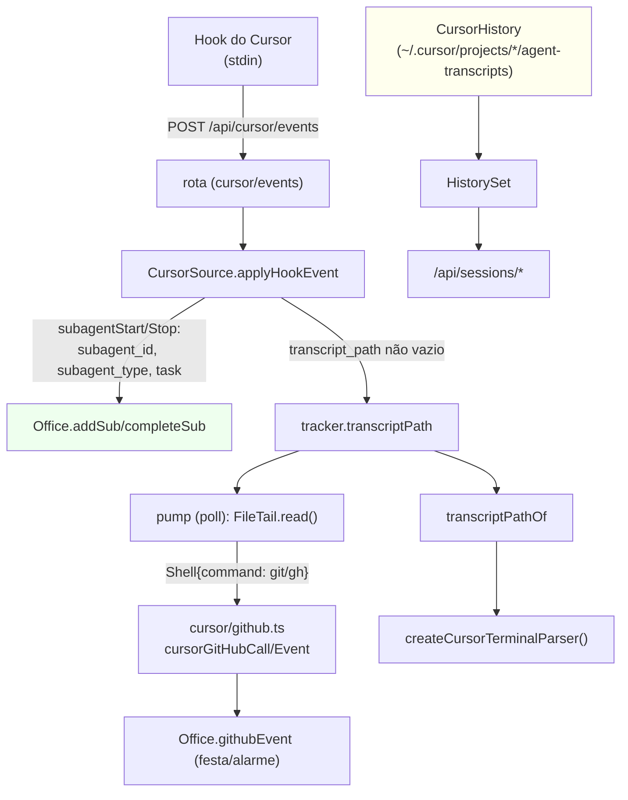

# Subagentes, GitHub e histórico do Cursor Design

**Spec**: `.specs/features/cursor-subagents-history/spec.md`
**Status**: Draft

---

## Architecture Overview

A Fase 4 é **puramente aditiva** e guardada por `provider` (conforme `AD-001`): a `CursorSource` já
existe (Fases 1–3) e passa a (1) tratar os hooks `subagentStart`/`subagentStop` criando/completando
subagentes no `Office`, (2) acompanhar o `transcript_path` com um **pump incremental** que detecta
`git`/`gh` nos `tool_use` `Shell` e emite `office.githubEvent`, e (3) ganhar um `HistoryProvider`
próprio (`CursorHistory`) registrado no `HistorySet` do servidor. Nada nas rotas (`http/sessions.ts`,
`http/terminal.ts`), no `Office` ou no cliente muda de contrato.



**Fluxo:** o hook manda o stdin. A fonte normaliza (`parseCursorEvent`), e para eventos de subagente
correlaciona o par por `subagent_id` e entra/sai do `Office` (`addSub`/`completeSub`). O
`transcript_path` guardado (Fase 3) passa a ser lido incrementalmente no `poll()`: o primeiro attach
faz `seekEnd()` (só o que for escrito depois vira evento) e cada `Shell{command}` com `git`/`gh` vira um
`office.githubEvent`. O histórico é um `HistoryProvider` à parte, registrado no `HistorySet` só quando
`config.cursor`; `resolve()` reusa `createCursorTerminalParser`. Sem transcript/histórico/efeitos, cada
peça degrada para o comportamento atual.

---

## Alternatives Considered

| # | Approach | Trade-off | Veredito |
| - | -------- | --------- | -------- |
| A | **Subagentes por hook** (`subagentStart`/`Stop`), correlação por `subagent_id` | É o único lastro confiável do par; espelha o Codex | ✅ **Escolhido** |
| B | Subagentes só pelo `Task` do transcript | O transcript não tem id de par nem parentesco; viraria sub "solto" | ❌ Rejeitado — o hook traz o id e o pai (P4) |
| C | **Pump do transcript** na fonte p/ git/gh | Reusa `FileTail` e `cursor/github.ts`; sem hook de shell confiável | ✅ **Choisen** |
| D | Detectar git/gh nos hooks `before/afterShellExecution` | A IDE não garante esses hooks p/ todo comando; e sem resultado não há desfecho | ❌ Rejeitado — menos cobertura que o transcript |
| E | Ler o transcript **desde o começo** p/ emitir efeitos | Reemitiria `git push` antigos → festa falsa ao abrir a sessão | ❌ Rejeitado — `seekEnd()` no primeiro attach |
| F | Detecção do GitHub **com resultado** (como Claude/Codex) | O Cursor não grava `tool_result`; não há saída para ler | ❌ Rejeitado — fallback só-comando, limitação documentada |
| G | `HistoryProvider` próprio (`CursorHistory`) no `HistorySet` | Mesma forma do Codex; zero rota nova | ✅ **Escolhido** |
| H | Listar os transcripts sem parser de terminal p/ título | O transcript não tem título; o 1º prompt é o melhor rótulo | ❌ Rejeitado — reusa `createCursorTerminalParser` |

---

## Code Reuse Analysis

### Existing Components to Leverage

| Component | Location | How to Use |
| --------- | -------- | ---------- |
| Subagentes do Office | `server/model/office.ts:573` `addSub`, `:610` `completeSub`, `:632` `reactivateSub`, `:643` `isSubDone`, `:546` `closeMain` (cascata) | Criar/completar os subagentes do Cursor |
| GitHub (regras) | `server/sources/github.ts:165` `bashCall`, `:235` `githubCallOf`, `:454` `detectGitHubResult` | Base da detecção do Cursor |
| Evento do GitHub no Office | `server/model/office.ts:512` `githubEvent` | Efeito de sala + atividade (mesmo caminho de Claude/Codex) |
| Evento do GitHub (puro) | `shared/github.ts:73` `githubEventKey`, `:86` `describeGitHubEvent` | Chave de dedupe e textos |
| Tail incremental | `server/sources/tail.ts:25` `FileTail` (`seekEnd` `:90`, `read` `:125`) | Pump do transcript sem reler |
| Extração de tool_use | `server/sources/cursor/transcript.ts:155` `toolBlocks` | Base do novo `cursorToolUses` (export) |
| Modelo de histórico | `server/sources/codex/history.ts:58` `CodexHistory` | Molde do `CursorHistory` |
| Histórico (contrato) | `server/sources/source.ts:138` `HistoryProvider`, `:149` `HistorySet` | Registrar o provedor do Cursor |
| Terminal (parser) | `server/sources/cursor/terminal.ts:178` `createCursorTerminalParser` | `createParser` do `resolve`; título do `list` |
| Agente aberto | `server/sources/history.ts:78` `openMainAgent`, `:22` `HISTORY_LIMIT`/`:20` `HISTORY_MAX_AGE_MS` | `open`/`agentId` do `SessionHistory` |
| Normalizador do Cursor | `server/sources/cursor/rollout.ts:93` `parseCursorEvent`, `:183` `statusBorder` | Campos de subagente + bordas |
| Contas | `server/accounts/service.ts:202` `entriesOf`, `:207` `allEntries` | Conta `'cursor'` p/ o `HistorySet` |

### Integration Points

| System | Integration Method |
| ------ | ------------------ |
| `POST /api/cursor/events` → `CursorSource.applyHookEvent` | Passa a tratar `subagentStart`/`subagentStop` |
| `CursorSource.poll()` | Passa a (a) completar subagentes expirados e (b) bombear o transcript (git/gh) |
| `Office.addSub`/`completeSub` | Recebem o subagente do Cursor (parentId, role, title) |
| `Office.githubEvent` | Recebe os eventos `pr_opened`/`pr_merged`/`push` lidos do transcript |
| `server/index.ts` | Registra `CursorHistory` no `HistorySet` quando `config.cursor` |
| `server/tsconfig.json` | `server/sources/cursor/{github,history}.ts` caem em `server/**` |
| Testes | `cursor/{rollout,source,github,history}.test.ts` (extensão/novos) |
| Docs | `docs/analise/06-arquitetura-proposta.md` §6.8 (workspace raiz) + `.specs/STATE.md` |

---

## Components

### `cursor/rollout.ts` — campos de subagente (modifica)

- **Purpose**: normalizar o que os hooks de subagente trazem.
- **Location**: `server/sources/cursor/rollout.ts`
- **Interfaces**:
  - `CursorEvent` ganha `subagentId?`, `subagentType?`, `subagentTask?`, `parentConversationId?`.
  - `parseCursorEvent` lê `subagent_id`/`subagentId`, `subagent_type`/`subagentType`, `task`,
    `parent_conversation_id`/`parentConversationId` (aliases defensivos).
  - `statusBorder` ganha `subagentStart` → `working` e `subagentStop` → `idle`.
- **Dependencies**: `../../../shared/activity`, `../../../shared/types`
- **Reuses**: `firstStr`/aliases defensivos do próprio arquivo

### `cursor/source.ts` — subagentes + pump do transcript (modifica)

- **Purpose**: tratar os hooks de subagente e detectar git/gh no transcript.
- **Location**: `server/sources/cursor/source.ts`
- **Interfaces**:
  - `CursorTracker` ganha `kind: 'main' | 'sub'`, `parentId?: string`, `tail?: FileTail`,
    `tailPath?: string`, `subDone?: boolean`.
  - `HOOK_EVENTS` ganha `subagentStart`/`subagentStop`.
  - `hookEvent`: um ramo de subagente (Start→`addSub`, Stop→`completeSub`, órfão/sem id→no-op).
  - `poll`: além da presença, `pumpGitHub(t)` para trackers com `transcriptPath`.
- **Dependencies**: `./github` (`cursorGitHubCall`/`cursorGitHubEvent`), `../tail` (`FileTail`)
- **Reuses**: `reconcile`, `decide`, `office.addSub`/`completeSub`/`githubEvent`

### `cursor/github.ts` — detecção git/gh do transcript (novo)

- **Purpose**: transformar um `tool_use` do Cursor em evento do GitHub.
- **Location**: `server/sources/cursor/github.ts`
- **Interfaces**:
  - `cursorGitHubCall(name, input): GitHubCall | undefined` — `Shell`→`Bash`, delega a `githubCallOf`.
  - `cursorGitHubEvent(call, result?): GitHubEvent | undefined` — com resultado usa `detectGitHubResult`;
    sem resultado, fallback só-comando (`pr_create`/`pr_merge` sem `--auto`/`push` sem dry-run/delete).
  - `cursorToolUses(line): Array<{name, input}>` — extrai os blocos de ferramenta da linha.
- **Dependencies**: `../github` (`githubCallOf`, `detectGitHubResult`, `GitHubCall`), `./transcript`
  (`cursorToolUses` de lá), `../../../shared/github` (`GitHubEvent`)
- **Reuses**: `githubCallOf`/`detectGitHubResult` (regras únicas do git/gh)

### `cursor/history.ts` — histórico do terminal do Cursor (novo)

- **Purpose**: listar/resolver as sessões do Cursor a partir dos transcripts da IDE.
- **Location**: `server/sources/cursor/history.ts`
- **Interfaces**:
  - `CursorHistory implements HistoryProvider` (`provider = 'cursor'`): `hasAccount`, `list`, `resolve`.
  - `list()`: varre `projects/*/agent-transcripts/<id>/<id>.jsonl`, devolve `RecentSession[]`.
  - `resolve(account, sessionId)`: valida e devolve `{ path, createParser }` ou 400/404.
- **Dependencies**: `../source` (`HistoryProvider`), `../history` (`openMainAgent`, limites),
  `./terminal` (`createCursorTerminalParser`), `./transcript` (`cursorToolUses` p/ o título via parser)
- **Reuses**: `mapLimit`/cache por mtime+tamanho (forma do `CodexHistory`)

### `server/index.ts` — registro no HistorySet (modifica)

- **Purpose**: ligar o `CursorHistory` quando o Cursor está ligado.
- **Location**: `server/index.ts`
- **Interfaces**: `if (history && cursor) history.add(new CursorHistory({ accounts: () => accounts.entriesOf('cursor'), openAgentOf: (acc, sid) => openMainAgent(office.list(), acc, sid) }));`
- **Dependencies**: `./sources/cursor/history`
- **Reuses**: `accounts.entriesOf`, `openMainAgent`

### Docs — roteiro + handoff

- **Purpose**: registrar a Fase 4 no roteiro (workspace raiz) e o estado no Handoff.
- **Location**: `docs/analise/06-arquitetura-proposta.md` §6.8 + `.specs/STATE.md`
- **Interfaces**: nota da Fase 4 apontando para `.specs/features/cursor-subagents-history/`.
- **Dependencies**: nenhuma

---

## Data Models

### `CursorEvent` (estendido)

```typescript
interface CursorEvent {
  // ...campos atuais (name, conversationId, workspaceRoot, cwd, toolName, toolInput,
  //    command, transcriptPath, tokens)
  subagentId?: string;            // subagent_id
  subagentType?: string;          // subagent_type (papel)
  subagentTask?: string;          // task (título)
  parentConversationId?: string;  // parent_conversation_id (pai)
}
```

### `CursorTracker` (estendido)

```typescript
interface CursorTracker {
  // ...campos atuais
  kind: 'main' | 'sub';        // 'sub' quando criado por subagentStart
  parentId?: string;           // chave do agente pai (só em 'sub')
  tail?: FileTail;             // pump do transcript (git/gh)
  tailPath?: string;           // caminho do tail (troca = novo arquivo)
  subDone?: boolean;           // o subagente já entregou
}
```

**Chaves:** o principal usa `<conta>:<conversationId>` (como hoje); o subagente usa
`<conta>:s:<subagentId>`, e o `parentId` é `<conta>:<parentConversationId>` (senão
`<conta>:<conversationId>`). Um `subagentStop` sem `Start` visto não tem tracker → no-op.

**Relação do pump:** `transcript_path` (hook) → `CursorTracker.transcriptPath` → `FileTail`
(`seekEnd` no 1º attach) → `cursorGitHubCall`/`cursorGitHubEvent` → `office.githubEvent`. Nenhum modelo
de produção existente muda (só campos opcionais).

---

## Error Handling Strategy

| Cenário | Tratamento | Impacto para o usuário |
| ------- | ---------- | ---------------------- |
| `subagentStop` sem `subagentStart` (órfão) | `completeSub` de inexistente = no-op; sem tracker, `return true` | Nada acontece; a sessão principal segue |
| `subagentStart` sem `subagent_id` ou sem pai | `return false`/no-op (não cria sub) | O subagente não aparece; nada quebra |
| `subagentStart` sem `subagentStop` | `poll()` completa o sub expirado (`completeSub`) | O sub vira `done` em vez de ficar preso |
| Transcript ausente/apagado | `FileTail.read()` devolve `missing`; o pump solta o tail e tenta reabrir | Sem efeitos; presença/atividades intactas |
| Transcript truncado/rotacionado | `r.reset` → `seekEnd()` (recomeça do fim) | Sem festa falsa do conteúdo antigo |
| Linha de transcript inválida/sem `tool_use` | `cursorToolUses` devolve `[]` | Nenhum evento; a leitura segue |
| Comando git/gh sem `tool_result` | Fallback só-comando (documentado); `push`/`pr` ainda animam | Possível falso positivo (v1, limitação conhecida) |
| `git push --dry-run`/`--delete`, `gh pr merge --auto` | Não emite (nada foi publicado) | Sem festa indevida |
| `list()` com transcript ilegível | Candidato ignorado (log `warnOnce`) | A listagem segue com os demais |
| `resolve` com id inválido/fora da pasta | 400 (id) / 404 (conta/sessão) | Nada de path traversal; nunca lança |
| `config.cursor` desligado | Sem `CursorHistory` no `HistorySet` | Claude/Codex inalterados |

---

## Risks & Concerns

| Concern | Location (file:line) | Impact | Mitigation |
| ------- | -------------------- | ------ | ---------- |
| **Falso positivo do fallback só-comando** (dados) | `cursor/github.ts` `cursorGitHubEvent` | `gh pr create` que falhou ainda dá festa | Limitação documentada; `seekEnd` e o dedupe do `githubEvent` reduzem o ruído; teste fixa a semântica |
| **Subagente preso em `working`** (regressão) | `source.ts` `poll` | Sub que nunca recebe Stop fica na tela | `poll` completa o sub ao expirar a presença; teste cobre |
| **Confundir o id do sub com o do principal** (fragile) | `source.ts` `hookEvent` | Sub sobrescrevendo a sessão principal | Chave `:s:` distinta; `kind`/`parentId` separados; teste cobre |
| **Reemitir efeitos ao abrir a sessão** (regressão) | `source.ts` `pumpGitHub` | Festa falsa de um `git push` antigo | `seekEnd()` no primeiro attach; teste cobre |
| **Pump concorrente com o terminal** (fragile) | `source.ts` `pumpGitHub` | Duas leituras do mesmo arquivo | Cada leitura tem seu próprio `FileTail`; o pump só lê o que chega depois |
| **`resolve` e path traversal** (security) | `cursor/history.ts` `resolve` | Ler arquivo fora da pasta da conta | Validar o id e resolver o caminho real dentro da conta; teste cobre |
| **`entriesOf('cursor')` sem conta** | `server/index.ts` | `CursorHistory` sem accounts | Só registra quando `config.cursor`; `hasAccount` devolve false sem accounts |
| **Regressão do Codex/Claude** (test gap) | `server/index.ts`, `sources/source.ts` | Ordem/registro do histórico muda | `HistorySet.add` aditivo; teste de despacho por conta |

---

## Tech Decisions

| Decision | Choice | Rationale |
| -------- | ------ | --------- |
| Lastro do subagente | Hook `subagentStart`/`subagentStop` (não o `Task` do transcript) | O hook traz `subagent_id` e `parent_conversation_id` (P4) |
| Correlação | Por `subagent_id`; órfão/sem id → no-op | Id estável do par; degradar é melhor que inventar |
| Chave do sub | `<conta>:s:<subagentId>` | Não colide com a do principal; `parentId` casa o pai |
| Onde detectar git/gh | Transcript (`Shell`), via pump incremental | Único registro confiável do comando |
| Primeiro attach | `seekEnd()` | Evita reemitir efeitos antigos |
| Sem `tool_result` | Fallback só-comando (`push`/`pr_create`/`pr_merge`), com as travas de `--dry-run`/`--delete`/`--auto` | Único lastro na v1; limitação documentada |
| CI/release do Cursor | **Não** emitidos | Sem saída não dá para saber o desfecho; não inventar |
| Histórico | `CursorHistory implements HistoryProvider` + `HistorySet` | Mesmo contrato do Codex; zero rota nova |
| Registro | Só com `config.cursor` | Desligar o Cursor não afeta Claude/Codex |
| Título do histórico | 1º prompt via `createCursorTerminalParser` | O transcript não tem título (Fase 3) |

> **Project-level decisions:** o design **conforma com `AD-001`** (fonte aditiva, guardada por
> `provider`) e **não** cria decisão nova em `.specs/STATE.md` — as escolhas são locais à feature.

---

## Tips

- **Um par por id**: o tracker do sub é a única memória; Start cria, Stop entrega, poll expira.
- **Nada de festa falsa**: `seekEnd` no 1º attach e as travas de `--dry-run`/`--delete`/`--auto`.
- **Não inventar**: sem `tool_result` não há desfecho — o fallback só-comando é a v1 documentada.
