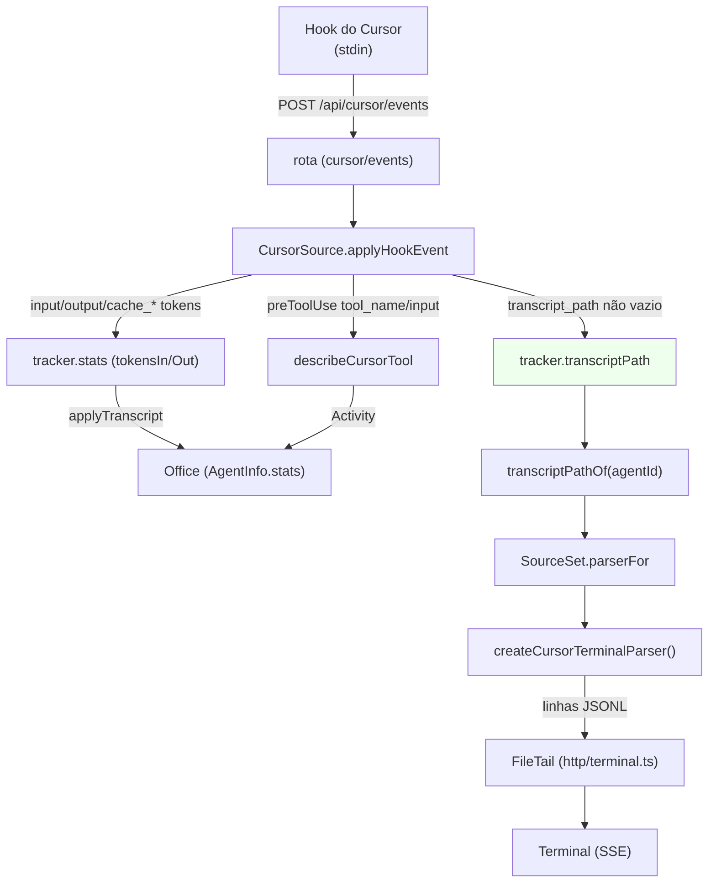

# Transcript do Cursor — terminal, atividades ricas e tokens Design

**Spec**: `.specs/features/cursor-transcript/spec.md`
**Status**: Draft

---

## Architecture Overview

A Fase 3 é **puramente aditiva** e toda guardada por `provider` (conforme `AD-001`): a `CursorSource`
já existe (Fase 1) e passa a (1) guardar o `transcript_path` que os hooks trazem, (2) acumular os
tokens dos eventos de hook e (3) traduzir melhor os nomes de ferramenta do Cursor. O terminal é um
**arquivo novo** (`cursor/terminal.ts`), no mesmo contrato dos outros (`TerminalParser`), ligado por
`terminalParser(agentId)` — nada nas rotas (`http/terminal.ts`), no `Office` ou no cliente muda.



**Fluxo:** o hook manda o stdin (com `transcript_path` e, em `stop`/`afterAgentResponse`, os campos
de token). A fonte normaliza (`parseCursorEvent`), guarda o caminho, acumula tokens (refletindo no
`Office`) e traduz a ferramenta. O terminal é montado sob demanda: a rota pergunta o caminho
(`transcriptPathOf`), escolhe o parser pela fonte (`SourceSet.parserFor`) e lê o arquivo JSONL com um
`FileTail` próprio. Sem caminho/campo, cada peça degrada para o comportamento atual.

---

## Alternatives Considered

| # | Approach | Trade-off | Veredito |
| - | -------- | --------- | -------- |
| A | **Terminal como parser novo** (`cursor/terminal.ts`) ligado por `terminalParser`, reusando `sources/terminal.ts` | Uma peça isolada e testável; zero muda nas rotas/Office/cliente; espelha o Codex | ✅ **Escolhido** |
| B | Reusar `cursor/transcript.ts` (o inspetor da POC) como base do terminal | O inspetor só extrai ferramentas e conta chaves; não monta a conversa (`user`/`assistant`/`system`) | ❌ Rejeitado — arquivo novo, inspetor fica |
| C | Ler tokens/transcript **do arquivo** (não do hook) num polling próprio | O Cursor não tem registro de sessões (C2) nem índice de transcripts; o hook já traz tudo | ❌ Rejeitado — duplicaria presença e não cobriria sessões fechadas |
| D | Derivar `TaskItem` de `UpdateCurrentStep` | `UpdateCurrentStep` é um **passo** ("o que estou fazendo agora"), não uma lista de tarefas; inventaria itens | ❌ Rejeitado — vira resultado documentado (P3) |
| E | Emitir `result` para cada `tool_use` (mesmo sem resultado) | O transcript observado **não** traz `tool_result`; inventaria saída | ❌ Rejeitado — ausência documentada (AC-08) |
| F | `transcriptPathOf` limpar o caminho quando o evento vier sem `transcript_path` | `beforeReadFile` traz `null` em conversa com caminho válido; limparia um caminho bom | ❌ Rejeitado — só grava, nunca limpa (AC-02) |

---

## Code Reuse Analysis

### Existing Components to Leverage

| Component | Location | How to Use |
| --------- | -------- | ---------- |
| Helpers do terminal | `server/sources/terminal.ts:133` `prepare`, `:140` `marked`, `:145` `oneLine`, `:281` `toolView`, `:27-37` `TEXT_MAX`/`INPUT_MAX`/`TITLE_ARG_MAX` | Base do parser do Cursor: montar título/input e cortar/mascarar |
| Contrato do terminal | `server/sources/terminal.ts:19` `TerminalParser` | A interface que `createCursorTerminalParser()` implementa |
| Terminal do Codex (referência) | `server/sources/codex/terminal.ts:73` `CodexTerminalParser`, `:348` `createCodexTerminalParser` | Mesma forma: emit, ids por posição, entradas user/assistant/tool/system |
| Fonte do Codex (referência) | `server/sources/codex/source.ts:263` `transcriptPathOf`, `:268` `terminalParser`, `:686` `applySummary` | Mesmo padrão de wiring e de `applyTranscript` |
| Fonte do Cursor | `server/sources/cursor/source.ts:121` `transcriptPathOf`, `:127` `terminalParser`, `:141` `applyHookEvent`, `:184` `reconcile` | Onde ligar caminho, tokens e o parser |
| Normalizador do Cursor | `server/sources/cursor/rollout.ts:65` `parseCursorEvent`, `:96` `describeCursorTool` | Acrescentar campos de token e traduções ricas |
| Tradução de atividades | `shared/activity.ts:605` `describeCommand`, `:650` `describeTool`, `:117` `maskSecrets` | Base de `describeCursorTool` (Shell→comando; resto→ferramenta) |
| Escritório | `server/model/office.ts:650` `applyTranscript`, `:79` `TranscriptSummary`, `:118` `AgentStats` | Refletir `tokensIn`/`tokensOut` no `AgentInfo` |
| Roteador de parser | `server/sources/source.ts:96` `transcriptPathOf`, `:108` `parserFor` | Escolhe o parser da fonte que conhece o transcript |
| Tail incremental | `server/sources/tail.ts:25` `FileTail` | O terminal (rota) já lê o arquivo; nada muda aqui |

### Integration Points

| System | Integration Method |
| ------ | ------------------ |
| `POST /api/cursor/events` → `CursorSource.applyHookEvent` | Passa a guardar `transcript_path` e acumular tokens (sem mudar a rota) |
| `SourceSet.parserFor` | Passa a devolver `createCursorTerminalParser()` quando o caminho veio do hook |
| `Office.applyTranscript` | Recebe `{ tasks: [], stats }` com os tokens acumulados do agente |
| `server/tsconfig.json` | `server/sources/cursor/terminal.ts` cai em `server/**` |
| Testes | `cursor/terminal.test.ts` (novo), `cursor/source.test.ts` (estende + corrige o caso do MVP), `cursor/rollout.test.ts` (estende) |
| Docs | `docs/analise/06-arquitetura-proposta.md` §6.8 (root) + `.specs/STATE.md` |

---

## Components

### `cursor/terminal.ts` — terminal da conversa (novo)

- **Purpose**: reconstruir a conversa da sessão (prompt, resposta, ferramentas, fim de turno) a partir
  das linhas JSONL do `transcript_path` do Cursor.
- **Location**: `server/sources/cursor/terminal.ts`
- **Interfaces**:
  - `createCursorTerminalParser(): TerminalParser` — um parser **novo** por leitura (guarda estado).
  - Interno `CursorTerminalParser.push(line): TerminalEntry[]` — `[]` para linha inválida/desconhecida,
    sem lançar.
  - Interno `cursorToolView(name, input): { tool; title; input?; inputKind? }` — traduz os nomes do
    Cursor para o estilo do `toolView`.
- **Dependencies**: `../terminal` (helpers), `node:path` indireto (via `toolView`)
- **Reuses**: `prepare`/`marked`/`oneLine`/`maskSecrets`/`toolView`/`TEXT_MAX`/`INPUT_MAX`

### `cursor/source.ts` — caminho, tokens e parser (modifica)

- **Purpose**: guardar o `transcript_path` por conversa, acumular tokens no `AgentStats` e devolver o
  parser do Cursor.
- **Location**: `server/sources/cursor/source.ts`
- **Interfaces**:
  - `CursorTracker` ganha `transcriptPath?: string`, `stats: AgentStats`.
  - `transcriptPathOf(agentId)`: `trackers.get(agentId)?.transcriptPath`.
  - `terminalParser(agentId)`: `trackers.has(agentId) ? createCursorTerminalParser() : undefined`.
  - `hookEvent`: grava `t.transcriptPath = event.transcriptPath` quando vem não vazio; soma
    `event.tokens` em `t.stats` e, no escritório, chama `office.applyTranscript(t.key, { tasks: [], stats })`.
- **Dependencies**: `./terminal` (`createCursorTerminalParser`), `./rollout` (`CursorEvent`)
- **Reuses**: `reconcile`, `decide`, `activityOf`, `office.applyTranscript`

### `cursor/rollout.ts` — tokens e traduções ricas (modifica)

- **Purpose**: normalizar os campos de token e traduzir `GetDynamicTools`/`AskQuestion`/`UpdateCurrentStep`.
- **Location**: `server/sources/cursor/rollout.ts`
- **Interfaces**:
  - `interface CursorTokens { input; output; cacheRead; cacheWrite }` e `CursorEvent.tokens?: CursorTokens`.
  - `parseCursorEvent`: lê `input_tokens`/`output_tokens`/`cache_read_tokens`/`cache_write_tokens`
    (aliases camelCase), campo ausente/não numérico = `0`; nenhum campo útil = `undefined`.
  - `describeCursorTool`: ramos para `GetDynamicTools` (`other`/"Carregando as ferramentas do Cursor"),
    `AskQuestion` (`ask`/"Fazendo uma pergunta a você") e `UpdateCurrentStep` (`plan`/"Etapa: …");
    `CallDynamicTool` com `toolName` `Task` vira `delegate` (via `describeTool('Task', …)`).
- **Dependencies**: `../../../shared/activity`, `../../../shared/types`
- **Reuses**: `describeCommand`/`describeTool`/truncate de `shared/activity`

### Docs — roteiro + handoff

- **Purpose**: registrar a Fase 3 no roteiro e o estado no handoff.
- **Location**: `docs/analise/06-arquitetura-proposta.md` §6.8 (root) + `.specs/STATE.md`
- **Interfaces**: nota da Fase 3 (transcript/tokens) apontando para `.specs/features/cursor-transcript/`.
- **Dependencies**: nenhuma

---

## Data Models

### `CursorEvent` (estendido)

```typescript
interface CursorTokens {
  input: number;       // input_tokens
  output: number;      // output_tokens
  cacheRead: number;   // cache_read_tokens
  cacheWrite: number;  // cache_write_tokens
}

interface CursorEvent {
  // ...campos atuais (name, conversationId, transcriptPath, toolName, toolInput, command...)
  tokens?: CursorTokens; // só quando algum dos quatro campos é um número finito
}
```

### `CursorTracker` (estendido)

```typescript
interface CursorTracker {
  // ...campos atuais
  transcriptPath?: string;    // gravado só quando um evento traz caminho não vazio; nunca limpo
  stats: AgentStats;          // { toolCalls: 0, tokensIn: 0, tokensOut: 0, subagents: 0 }
}
```

**Regra dos tokens (v1):** `tokensIn += input + cacheRead + cacheWrite`, `tokensOut += output`, a cada
evento que traga campos. Como `stop` e `afterAgentResponse` podem repetir o total do turno, o número é
um **limite superior** (aceito na v1); nenhum campo ausente zera o acumulado.

**Relationships:** `transcript_path` (hook) → `CursorTracker.transcriptPath` → `transcriptPathOf` →
`SourceSet.parserFor` → `createCursorTerminalParser`. Os tokens (hook) → `CursorTracker.stats` →
`Office.applyTranscript` → `AgentInfo.stats`. Nenhum modelo de produção existente muda (só campos
opcionais).

---

## Error Handling Strategy

| Cenário | Tratamento | Impacto para o usuário |
| ------- | ---------- | ---------------------- |
| Evento sem `transcript_path` (ou `null`) | Não grava/limpa; `transcriptPathOf` segue `undefined` (ou o valor antigo) | Sessão sem terminal, como hoje; nada quebra |
| `transcript_path` aponta arquivo ausente/opaco | O `FileTail` do terminal devolve `missing`/sem linhas; a rota segue | Terminal vazio/erro tratado pela rota existente |
| Linha de transcript inválida/desconhecida | `push` devolve `[]`, sem lançar | Nenhuma entrada para aquela linha; a leitura segue |
| Bloco `tool_use` sem o argumento esperado | Título possível (ex.: `Bash`), sem lançar | Entrada de ferramenta sem o detalhe |
| Campo de token não numérico | Ignorado (`0`); `tokens` pode ficar `undefined` | Número não muda; nunca regride |
| `stop`+`afterAgentResponse` repetem o total | Soma (limite superior) | Tokens podem ficar acima do real na v1 |
| Ferramenta do Cursor sem tradução | Cai no genérico do `describeTool` (`Usando …`) | Balão genérico, sem quebrar |
| Transcript sem checklist | Nenhum `TaskItem` derivado | `tasks` vazio; ausência documentada |

---

## Risks & Concerns

| Concern | Location (file:line) | Impact | Mitigation |
| ------- | -------------------- | ------ | ---------- |
| **Tokens contados em dobro** (dados) | `rollout.ts` `parseCursorEvent` + `source.ts` `hookEvent` | `tokensIn`/`tokensOut` acima do real quando `stop` e `afterAgentResponse` repetem o total | Aceito como limite superior na v1; documentado; um teste fixa a semântica (soma) |
| **`transcript_path` nulo apaga um caminho bom** (regressão) | `source.ts` `hookEvent` | Perder o terminal de uma conversa viva | Só grava quando o campo vem não vazio; nunca limpa; teste cobre |
| **Nomes de argumento divergentes** (fragile) | `cursor/terminal.ts` `cursorToolView` | `Write` usa `contents`; `StrReplace` usa `path`; `Glob` usa `glob_pattern` | Mapear para o canonical do `toolView` (`content`/`file_path`/`pattern`); teste por ferramenta |
| **Ids por posição** (limitação) | `cursor/terminal.ts` `push` | Duas linhas idênticas viram duas entradas (não há id no transcript) | É a ordem do arquivo; o `FileTail` não relê; ids `l{n}:{bloco}` |
| **Atividade rica regride o caminho por hook** (test gap) | `rollout.ts` `describeCursorTool` | `preToolUse` passa a traduzir diferente do que já testávamos | Testes cobrem os novos nomes e mantêm os antigos |
| **Caso antigo "MVP sem transcript"** (test gap) | `cursor/source.test.ts:181-186` | O teste antigo exige `terminalParser` `undefined`, que deixa de valer | Substituir por: sem caminho → `transcriptPathOf` `undefined`; com caminho → parser definido |
| **`transcriptPathOf` responde por agente fora do escritório** | `source.ts` `transcriptPathOf` | O terminal (rota) já exige `office.has(agentId)` antes; sem impacto | Devolver o caminho do tracker; a rota valida o agente |

---

## Tech Decisions

| Decision | Choice | Rationale |
| -------- | ------ | --------- |
| Onde o terminal mora | `cursor/terminal.ts` (novo), ligado por `terminalParser` | Mesmo contrato das outras ferramentas; zero rota/cliente |
| Ids das entradas | Por **posição** da linha + índice do bloco (`l{n}`) | O transcript não traz id; o `FileTail` não relê (ids estáveis por leitura) |
| Timestamp das entradas | `timestamp`/`ts` quando houver; senão o último; `Date.now()` só como reserva | O transcript do Cursor não grava horário |
| `transcript_path` nulo | Não grava/limpa | É o campo estável por conversa; `null` aparece em eventos parciais |
| Acúmulo de tokens | Somar cada evento que traga campos | Instrução da fase; se repetir o total, vira limite superior (v1) |
| `ToolView` dos nomes do Cursor | Mapear `Shell`→Bash, `StrReplace`→Edit, `Write.contents`→`content`, `Glob.glob_pattern`→`pattern`, `CallDynamicTool`→`mcp__…` | Reusa `toolView`; mantém o título no estilo do Claude Code |
| Atividades ricas | Só `GetDynamicTools`/`AskQuestion`/`UpdateCurrentStep` (e `Task` dinâmico) ganham ramo dedicado | O resto já passa no `describeTool` com nome cru |
| Tarefas | **Não** derivar | Nenhuma ferramenta/traço de checklist observado (P3) |
| Resultados | **Não** emitir `result` | O transcript não traz `tool_result` (AC-08) |

> **Project-level decisions:** o design **conforma com `AD-001`** (fonte aditiva, guardada por
> `provider`) e **não** cria decisão nova em `.specs/STATE.md` — as escolhas são locais à feature.

---

## Tips

- **Uma linha, um contexto**: o parser guarda só o último `at` e o contador de posição; todo o resto é
  local à linha.
- **Título primeiro**: a maior parte do valor está em `cursorToolView` (título legível); o `input` é
  bônus.
- **Não inventar**: sem resultado no transcript e sem checklist, o certo é a ausência documentada.
