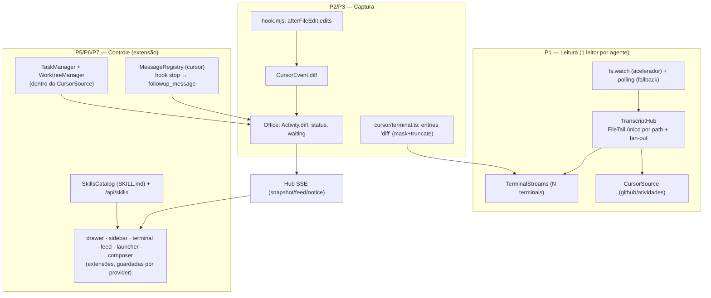

# Sala de Controle — Design

**Spec**: `.specs/features/sala-de-controle/spec.md`
**Context**: `.specs/features/sala-de-controle/context.md` (decisões das rodadas 1–5)
**Status**: Draft

---

## Princípio de arquitetura

**"Adicionar ao que existe hoje."** Nenhuma superfície, app ou plano de dados novo. Cada peça é uma
**extensão** de um ponto que já existe — `AgentSource`, `Office`, `MessageRegistry`,
`TerminalStreams`, `UiComponent` e os componentes atuais (`drawer`, `sidebar`, `terminal`, `feed`,
`launcher`, `composer`) — **aditiva e guardada por `provider`**. Claude/Codex permanecem idênticos.

Conforma **AD-001** (fonte aditiva; arquivos compartilhados com guarda por `provider`) e **AD-002**
(política local do Cursor em `~/.habblaud/cursor-hook.json` intacta).

As "views" das histórias P3/P4 são **modos/filtros dentro do shell atual**, não páginas novas.

---

## Architecture Overview



Cadeia de latência (a meta da spec mede **a partir da linha gravada no disco**): `fs.watch` →
`TranscriptHub` (1 leitura) → fan-out → SSE. O flush do transcript pelo Cursor fica fora do nosso
controle (hipótese do runbook).

---

## Code Reuse Analysis

### Existing Components to Leverage

| Component | Location | How to Use |
| --------- | -------- | ---------- |
| `FileTail` (leitura incremental) | `server/sources/tail.ts:25` | O `TranscriptHub` passa a **ser o dono** do único `FileTail` por path (hoje um por stream) |
| Padrão `fs.watch` + `schedule()` | `server/sources/watcher.ts:830-871`, `:243-251` | Mesmo padrão "watch acelera, polling cobre" no hub |
| `TerminalStreams` / `TranscriptSource` / `ConversationSource` | `server/http/terminal.ts:97-151,190-341` | `serve`/`pump` passam a consumir o hub em vez de criar `FileTail` por stream |
| `TerminalParser` + `parseInto` | `server/http/terminal.ts:80`, `server/sources/terminal.ts:770` | Parsers continuam por assinante; o hub entrega **linhas** |
| `createCursorTerminalParser` | `server/sources/cursor/terminal.ts:178` | Ganha o bloco de **diff** da edição |
| `diffInput` / `MultiEdit` / `Write` | `server/sources/terminal.ts:253,295,306` | Base do diff do Cursor (mesmo formato já renderizado pelo cliente) |
| `describeCursorTool` / `parseCursorEvent` / `StrReplace` | `server/sources/cursor/rollout.ts:152,187` | Ganham o resumo de diff na `Activity` |
| `MessageRegistry` (`send`/`inbox`/`ack`/`canMessage`) | `server/messages/registry.ts:178-333` | Fila reutilizada para o Cursor (hoje só Claude/Codex) |
| `Hub` SSE + `OfficeSnapshot.meta` | `server/http/sse.ts:12`, `shared/types.ts:331-362` | `meta.messages`/`meta.terminal` já governam; idem para o novo canal |
| `Office.ensureRoom` / `roomId=normalizeCwd(cwd)` | `server/model/office.ts:1021,317`; `server/model/rooms.ts` | Salas por projeto já existem; estende-se ao headless |
| `groupRooms` / `computeCounters` / `waitingAgents` | `client/src/ui/model.ts:357,65,82` | Base do mosaico e da fila (mesmos dados) |
| `diffLineKind` / `fillDiff` | `client/src/ui/terminal.ts:321,388` | Render do diff inline **sem componente novo** |
| `providerOf` / `isCodex` | `client/src/ui/provider.ts:11-18` | Guarda por provedor |
| `DayLauncher` (launcher) | `client/src/ui/index.ts:162` | Padrão de launcher reusado pela ação "Nova tarefa" |
| `composer-model.ts` (`CURSOR_OFF_TEXT`, `composerMode`) | `client/src/ui/composer-model.ts:13,31,38` | O composer volta a funcionar p/ Cursor quando há canal (P6) |
| `notify.ts` (badge "precisa de você") | `client/src/ui/notify.ts:41-56` | Já conta `waiting`; base do badge da fila |
| `UiComponent` + registro | `client/src/ui/index.ts:177,186`; `context.ts:7-12` | Novos modos entram como `UiComponent` (e `PanelName` é estendido) |

### Integration Points

| System | Integration Method |
| ------ | ------------------ |
| `POST /api/cursor/events` (`server/cursor/http.ts`) | Já recebe hooks; passa a carregar `edits` no payload de `afterFileEdit` |
| `POST /api/messages` + `POST /api/mod/inbox` (`server/messages/http.ts`) | Fila reutilizada; novo poller do Cursor no `hook.mjs` (`stop`) |
| `PATCH`/rotas novas em `server/http/app.ts` (`ApiDeps`) | Rotas de tarefas (`/api/tasks*`) e skills (`/api/skills*`) entram como `deps` novas |
| CLI headless `cursor-agent`/`agent` | `spawn` em `TaskManager`; stdout `--output-format stream-json` normalizado |
| Salas (`Office`/`rooms.json`) | Tarefa headless entra na sala do **repositório de origem** com rótulo |

---

## Components

### 1. `TranscriptHub` — leitura única com fan-out (P1 · SC-01..SC-05)

- **Purpose**: um único leitor por transcript, com fan-out para N terminais e para a fonte; `fs.watch`
  como acelerador, polling como fallback.
- **Location**: `server/sources/transcript-hub.ts` (novo).
- **Interfaces**:
  - `subscribe(path: string, consumer: HubConsumer, opts?: { intervalMs?: number }): Subscription`
  - `HubConsumer { onRead(read: TailRead): void }` — recebe o `TailRead` (linhas novas, `reset`, `missing`)
  - `Subscription { unsubscribe(): void }`
  - internamente: `Map<string, SharedPath { tail: FileTail; watcher?: FSWatcher; timer; consumers: Set<...>; schedule() }>`
- **Comportamento**: o `FileTail` compartilhado posiciona em `seekEnd()` na criação; `fs.watch(path)` e um
  timer de polling (fallback) disparam `tick()`, que lê uma vez (respeitando `READS_PER_POLL` e o
  orçamento de bytes) e entrega o mesmo `TailRead` a todos os assinantes. Rajadas preservam a ordem
  (SC-03). O `init` (janela de 4 MB) continua sendo leitura pontual por assinante (como hoje).
- **Dependencies**: `FileTail` (`tail.ts`), `SourceSet.parserFor`/`transcriptPathOf`.
- **Reuses**: `FileTail`, padrão `fs.watch`+`schedule` de `watcher.ts`, constantes de `http/terminal.ts`.
- **Não muda**: limite de `MAX_STREAMS`, formato `init`/`append`, demo/histórico (seguem com timer próprio).

### 2. `CursorSource` (extensão) — presença acelerada + tarefas (P1/P5)

- **Purpose**: a fonte do Cursor passa a (a) assinar o `TranscriptHub` para ler o transcript uma vez e
  reagir ao vivo e (b) hospedar o ciclo de vida das tarefas headless (sem criar um segundo `Provider`).
- **Location**: `server/sources/cursor/source.ts` (modificar) + módulos novos abaixo.
- **Interfaces** (novas): `tasks(): CursorTaskInfo[]`, `createTask(input: TaskInput): Promise<CursorTaskInfo>`,
  `stopTask(id)`, `resumeTask(id)`, `removeTask(id)`; `transcriptPathOf`/`terminalParser` passam a
  atender também os agentes de tarefa (transcript = JSON normalizado do stream-json).
- **Dependencies**: `TaskManager`, `WorktreeManager`, `TranscriptHub`.
- **Reuses**: `AgentSource`, `Office.addMain/addActivity`, `STALE_PRESENCE_MS`/`reconcile` já existentes.

### 3. Captura do diff no hook — `hook.mjs` + `rollout.ts` (P2 · SC-06..SC-09)

- **Purpose**: levar o diff real da edição (`afterFileEdit`) da borda até a `Activity`/terminal.
- **Location**: `mod/habblaud-cursor/hook.mjs` (`toolInputOf`, :117) e `server/sources/cursor/rollout.ts`
  (`CursorEvent`, `parseCursorEvent`, `describeCursorTool`).
- **Interfaces**: `CursorEvent` ganha `diff?: { file: string; edits: Array<{ old: string; new: string }> }`
  (já mascarado/truncado no servidor); `Activity` ganha `diff?: EditDiff` (resumo).
- **Reuses**: `maskSecrets`/`truncate` (`shared/activity.ts`), `describeCursorTool`.
- **Nota**: o `hook.mjs` **não** mascara (só transporta); a máscara/truncamento é sempre no servidor.

### 4. Diff no terminal do Cursor — `cursor/terminal.ts` (P2 · SC-06..SC-09)

- **Purpose**: o parser do Cursor emite entradas `kind:'diff'` para `StrReplace`/`Write`/`MultiEdit`,
  reusando o mesmo formato do Claude — o cliente já sabe desenhar.
- **Location**: `server/sources/cursor/terminal.ts` (modificar).
- **Reuses**: `diffInput`/`MultiEdit`/`Write` (`server/sources/terminal.ts:253-308`),
  `TerminalInputKind = 'diff'` (`shared/types.ts:443`), `diffLineKind`/`fillDiff` (cliente).
- **Degradação**: sem `old_string`/`new_string` no input, cai no comportamento atual (sem diff).

### 5. Triagem "Precisa de você" (P3 · SC-10..SC-16)

- **Purpose**: consolidar permissão + `ask` + falha numa fila, num **modo/filtro dentro do shell**.
- **Location**: `client/src/ui/inbox-model.ts` (novo, puro) + extensão de `client/src/ui/drawer.ts`
  (`AgentView` já tem o alerta "Precisa de você", :315) e `client/src/ui/permission.ts`.
- **Interfaces**: `waitingItems(snapshot: OfficeSnapshot): WaitingItem[]` (ordenado por espera).
- **Reuses**: `AgentInfo.waitingFor`/`permission`, `Activity.kind:'ask'`+`questions`,
  `computeCounters`/`waitingAgents`, decisão de permissão já existente (`store.ts:241,257`), `notify.ts`.
- **SC-14** (responder `ask` pela fila) usa o canal da P6; sem canal, o CTA leva à sessão.
- **SC-16**: deep-link é *best-effort*; senão, `TerminalControl.open` foca o agente no escritório.

### 6. Mosaico de sessões (P4 · SC-17..SC-20)

- **Purpose**: um **modo de layout** dos dados que já existem (cards compactos por agente).
- **Location**: `client/src/ui/mosaic-model.ts` (novo, puro) + `client/src/ui/mosaic.ts` (UiComponent).
- **Interfaces**: `mosaicCards(snapshot): Array<{ agentId; roomId; provider; status; activity?; diff? }>`
  (reusa `groupRooms`).
- **Reuses**: `groupRooms` (`model.ts:357`), `STATUS_LABEL`, `Activity.diff`, `TerminalControl.open`.
- **SC-19**: reusa `notify.ts` (badge + notificação do sistema). **SC-20**: rolagem preservando
  `waiting` visível (ordenação no modelo, não no CSS).

### 7. Tarefas headless — `TaskManager` + `WorktreeManager` (P5 · SC-21..SC-26)

- **Purpose**: abrir/parar/retomar tarefas isoladas, observáveis como uma sessão comum.
- **Location**: `server/sources/cursor/tasks.ts`, `server/sources/cursor/worktree.ts`,
  `server/sources/cursor/stream.ts` (novos) + rotas em `server/http/app.ts`.
- **Interfaces**:
  - `TaskManager.create(input): Promise<CursorTaskInfo>` — monta a linha de comando
    (`agent -p --trust --force --output-format stream-json --stream-partial-output`, com `--mode`,
    `--model`, `--workspace`, `--resume`), faz `spawn`, grava o stdout num JSONL e alimenta o Office.
  - `TaskManager.stop(id)` / `resume(id)` / `remove(id)` / `list()` / `reconcile()` (no boot).
  - `WorktreeManager.create(repo, taskId): { dir, branch }` / `remove(...)` — `git worktree add`+branch;
    **nunca** remove worktree com alterações não commitadas (SC-23).
- **Reuses**: `Office.addMain/addActivity`, salas (`ensureRoom`), padrão de `spawn` já usado em
  `server/messages/codex.ts`.
- **SC-24**: `stream.ts` **normaliza** o stream-json num JSONL equivalente ao transcript Cursor, de modo
  que o `createCursorTerminalParser` e as atividades funcionem sem caminho novo. *(Ver risco R-2:
  mapeamento do stream-json a confirmar; cai para um parser mínimo se o formato divergir.)*
- **SC-26**: binário ausente / falha de worktree → erro acionável + tarefa `failed`.

### 8. Mensagem na conversa do Cursor (P6 · SC-27..SC-31)

- **Purpose**: enfileirar uma mensagem e entregá-la ao fim do turno, com trava de segurança.
- **Location**: `server/messages/registry.ts` (estender) + `server/messages/http.ts` (rota de poll do
  Cursor) + `mod/habblaud-cursor/hook.mjs` (evento `stop`).
- **Interfaces**:
  - `MessageRegistry.canMessage` ganha o ramo `cursor` (presença via hook, como o Claude).
  - `MessageRegistry.cursorPoll(session)` entrega **uma** mensagem `queued` por conversa (estado
    `queued → sent → delivered/failed`) e mantém o contador de auto-followups.
  - `hook.mjs`, no `stop`, consulta o poller e, havendo mensagem, devolve `{ followup_message: text }`.
- **Regra**: `SC-29` — após **N=5** entregas automáticas consecutivas sem resposta do usuário, o
  escritório para e exige ação explícita (retoma ao ver um novo prompt do usuário no transcript).
- **Reuses**: fila `MessageRegistry` (`registry.ts:179`), `describeMessage`, `composer-model.ts`.
- **SC-30**: sem canal, o composer fica **oculto/desabilitado** com `CURSOR_OFF_TEXT` (sem regressão à Fase 5).
- **SC-31**: a fila é do servidor (sobrevive a reconexões); entrega é idempotente por `id`.

### 9. Catálogo de skills (P7 · SC-32..SC-34)

- **Purpose**: listar skills dos diretórios conhecidos e disparar como prompt na sessão-alvo.
- **Location**: `server/skills/catalog.ts` + `server/skills/http.ts` (novos) + `client/src/ui/skills.ts`.
- **Interfaces**: `listSkills(roots): SkillInfo[]` (lê `SKILL.md`, *frontmatter* `name`/`description`);
  `POST /api/skills/run {agentId, skill}` → injeta o prompt (headless direto; IDE pela fila da P6).
- **Reuses**: `UiComponent`/`providerOf`; canal de sessão (P5/P6).
- **SC-34**: `SKILL.md` malformado → `available:false` (não derruba o painel).

### 10. Salas por projeto (P8 · SC-35..SC-40)

- **Purpose**: cada projeto é uma sala; a tarefa headless cai na sala do **repositório de origem**.
- **Location**: `server/model/office.ts` / `server/model/rooms.ts` (extensão pontual) + testes.
- **Reuses**: `ensureRoom`/`roomId=normalizeCwd`, `roomDisplayNames` (desambiguação por pais),
  herança de sala do subagente (`office.ts:587`), persistência de rename (`rooms.json`).
- **SC-40**: tarefa em worktree → `roomId = normalizeCwd(repoDeOrigem)`, com o nome da tarefa/branch
  como rótulo do agente.

---

## Data Models

```typescript
// shared/types.ts (aditivo, opcional — não quebra protocolo)

/** Resumo do diff de uma edição, para a Activity/mosaico (conteúdo completo fica no terminal). */
export interface EditDiff {
  file: string;
  added: number;
  removed: number;
  truncated?: boolean;
}

// Activity ganha:
//   diff?: EditDiff

/** Tarefa headless gerenciada (aparece no snapshot; ver P5). */
export interface CursorTaskInfo {
  id: string;
  prompt: string;
  mode: 'plan' | 'ask' | 'agent';
  model?: string;
  /** Agente do Office que representa a tarefa (observabilidade normal). */
  agentId: string;
  /** Sala (projeto de origem). */
  roomId: string;
  /** Rótulo: nome da tarefa ou da branch. */
  label: string;
  worktree?: string;
  branch?: string;
  status: 'starting' | 'running' | 'stopped' | 'failed' | 'done';
  pid?: number;
  sessionId?: string;
  createdAt: number;
  error?: string;
}

/** Skill do catálogo (P7). */
export interface SkillInfo {
  name: string;
  description?: string;
  source: 'project' | 'agents' | 'user';
  path: string;
  available: boolean;
}

/** Item da fila "Precisa de você" (modelo do cliente, puro). */
export interface WaitingItem {
  agentId: string;
  roomId: string;
  kind: 'permission' | 'ask' | 'error';
  reason: string;      // AgentInfo.waitingFor
  since: number;       // AgentInfo.statusSince
  questions?: AskQuestion[];
  permissionId?: string;
}
```

`OfficeSnapshot.meta` ganha `tasks?: boolean` (recurso ligado) — governado pela trava do terminal, como
`messages`/`terminal`. A lista de tarefas viaja em `OfficeSnapshot` (campo aditivo `tasks?: CursorTaskInfo[]`).

---

## Error Handling Strategy

| Cenário | Tratamento | O que o usuário vê |
| ------- | ---------- | ------------------ |
| `fs.watch` indisponível/perde eventos (SC-04) | Fallback a polling no `TranscriptHub` | Mesmo terminal, dentro do limite de polling |
| Transcript ausente/ilegível (SC-01) | `init` vazio; assume `seekEnd` ao surgir | Estado vazio, sem erro |
| Diff acima do limite (SC-08) | Truncar com indicador; completo sob demanda | Diff cortado + "ver completo" |
| Segredo no diff (SC-09) | `maskSecrets` antes de exibir/persistir | `•••` no lugar do segredo |
| Binário headless ausente (SC-26) | Erro acionável; tarefa `failed` | Mensagem de erro + botão de instalar |
| Worktree com alterações não commitadas (edge SC-23) | Não apagar; sinalizar conflito | Aviso; o diretório fica |
| Tarefa órfã após restart (SC-25) | `reconcile()` no boot marca `stopped` | Tarefa "parada" |
| Canal de mensagem desligado (SC-30) | Composer oculto/desabilitado | `Para responder, use o Cursor` |
| Loop de auto-followup (SC-29) | Trava em N=5; exige ação | Estado "aguardando você" |
| `SKILL.md` malformado (SC-34) | `available:false` | Item marcado como indisponível |
| Rota não-local (trava existente) | 403 como hoje | — |

---

## Risks & Concerns

| Concern | Location (file:line) | Impact | Mitigation |
| ------- | -------------------- | ------ | ---------- |
| Refatorar o tailer compartilhado pode regredir o terminal do Claude/Codex (fragile, perf) | `server/http/terminal.ts:97-341` | Terminal lento/quebrado nas outras fontes | Hub com guarda por caso; testes "dois terminais do mesmo agente", `/clear` e reconexão (SC-05) |
| Formato do stream-json do `agent -p` não mapeado a `TerminalEntry` (incerteza) | `server/sources/cursor/stream.ts` (novo) | Tarefa headless sem observabilidade | Spike + *fallback* a parser mínimo; normalizar para o JSONL já lido pelo `createCursorTerminalParser` (R-2) |
| `MessageRegistry` valida `canMessage`/`unavailableReason`; Cursor hoje sem entregador | `server/messages/registry.ts:147-152,235-241` | Composer oferecido sem conseguir entregar | Só habilitar `cursor` **com** o poller no hook; senão degrada oculto (SC-30) |
| Nenhum precedente de fonte que lança processo | `server/sources/*` | Vazamento de processo / órfãos | `TaskManager` com `reconcile()` no boot, `unref` e encerramento no `stop()` (SC-25) |
| `provider 'cursor'` único: um segundo `AgentSource` colidiria em `SourceSet.of` | `server/sources/source.ts:58` | Fonte errada resolvida | Estender o `CursorSource` existente (sem novo provider) |
| Sem jsdom nos testes do cliente | `vitest.config.ts:5-6` | UI nova difícil de testar | Lógica em `*-model.ts` puro (padrão da casa: `model.ts`, `composer-model.ts`) |
| Diff pode trafegar segredo entre hook e servidor | `mod/habblaud-cursor/hook.mjs` | Vazamento em log/rede local | Máscara **sempre** no servidor antes de exibir/persistir (SC-09) |
| `cursor/source.ts` já lê o transcript (github) | `server/sources/cursor/source.ts` | 2 leitores por agente ⇒ fere SC-05 | `CursorSource` passa a assinar o `TranscriptHub` (1 leitor por path) |

> Sem `AGENTS.md`/`CONTRIBUTING.md` no repo; aplicam-se os padrões fortes (cobertura por AC).

---

## Tech Decisions

| Decision | Choice | Rationale |
| -------- | ------ | --------- |
| Onde vive o controle headless | **Estender o `CursorSource`** (sem novo `Provider`) | AD-001 trata de **ferramenta** nova; aqui é a mesma ferramenta, e `SourceSet.of` colidiria com dois `cursor` |
| Leitor de transcript | `TranscriptHub` dono do único `FileTail` por path, fan-out a terminais + fonte | SC-05; reusa o padrão `fs.watch` existente |
| Janela do `init` | Leitura pontual por assinante (como hoje) | Evita conflito de janela (4 MB no terminal × *from-end* na fonte) |
| Diff: fonte da verdade | Terminal via parser do transcript; `Activity.diff` (resumo) via hook | O cliente já renderiza `kind:'diff'`; o mosaico só precisa do resumo |
| Mensagem na IDE | Fila `MessageRegistry` + poller no `hook.mjs` (`stop`) | Reusa a infraestrutura existente; entrega no único ponto que o Cursor aceita |
| Trava de loop | Contador de entregas automáticas consecutivas (N=5) + reset ao ver prompt do usuário | SC-29; evita loop com a IA |
| Skills | Catálogo *read-only* + prompt pela sessão existente | SC-32..34; sem executar skills fora do Cursor |
| UI nova | `UiComponent`/`PanelName` (modos/filtros), nunca página separada | Decisão do usuário: "adicionar ao que existe" |

> **Decisão de projeto?** Nenhuma que vire `AD-NNN`: as escolhas acima são locais à feature e conformam
> aos AD-001/AD-002 vigentes.
